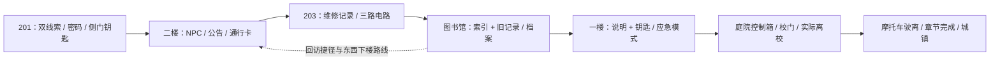

# 《逃离考场》开发过程与后续交接

整理日期：2026-10-24。本文是当前开发交接入口。旧编号文档保留各阶段当时的状态，不能把其中“本版本仅完成某一步”当作最新结论。继续开发时同时核对本文件、实际分支 HEAD 和代码。

## 1. 当前完成程度

**当前是可自动跑通第一章主要路线的 Unity 原型，第 0—4 步完成，第 5 步功能与自动验证已接通；三次人工试玩和发布验收仍未完成。** 详情见 [第 5 阶段](20-V1.2手账叙事与存档恢复.md)。

- [x] 201 → 二楼走廊 / 203 → 三楼图书馆 → 一楼配电间 → 庭院 → 校门 → 摩托车驶离，主玩法路线接通。
- [x] 第一人称、米制人物与桌椅、有顶室内、碰撞、楼梯、检查点回位、教师导航和广播调查已有实现。
- [x] 机关字段接入原 JSON 存档，已有门锁、导航障碍、照明状态的保存 / 读取检查。
- [x] 自动完整路线、原摩托物理回归、七个旧独立场景的短时 Play 启动检查通过。
- [x] Tab 手账、已发现线索 / 道具 / 区域、三级主动提示及模态输入互斥已接入。
- [x] 统一字幕事件、SaveData v2、旧档迁移规则及真实场景重载的位置 / 朝向 / 区域 / 检查点恢复已实现并自动验证；骑行读取为合法检查点步行。
- [ ] 三次人工完整试玩、极端帧率与贴角跳跃验收、旧场景完整通关、发行构建验收未完成。
- [ ] 高质量美术、正式声音 / 配音、完整联机游戏未完成。

“已实现”不等于“所有使用条件都验收通过”。历史自动测试不能代替人工试玩。

## 2. 工程版本、分支与获取方式

| 项目 | 当前值 |
| --- | --- |
| 仓库 | [fangfangzhouhang/gta-style-unity-prototype](https://github.com/fangfangzhouhang/gta-style-unity-prototype) |
| 继续开发分支 | `feature/campus-v12-chapter-one` |
| 当前审查 PR | [#11](https://github.com/fangfangzhouhang/gta-style-unity-prototype/pull/11)，第五阶段草稿，不自动合并 main；原 #9 已此前合并 |
| 当前 main | `99324a29afea44ebc7a63b1ed951a31d58362f1c`，已含 #9 和独立 ArtLab201 的 #10；本功能分支已合入此 main |
| V1.2 设计基线 | `907906b39a6d8c7b6358299a1776cba3aa3292dc`，v11 / PR #8 |
| 第 4 阶段验证代码 | `204dac9309dd2539662031960fcdb7d750521aac` |
| 第 5 阶段起始 | `ddc70ca`；原 `ae14cb3` 草稿已增量接入 Assets，原稿仍作为历史保留 |
| 本次交接版本 | 上述代码及本次文档提交，最终提交号用 `git log -1` 查询 |
| Unity | **2022.3.49f1c1**，见 `ProjectSettings/ProjectVersion.txt` |
| 渲染 / 输入 | Built-in Render Pipeline / 旧 Input Manager |
| 主场景 | `Assets/Scenes/CampusWorld.unity` |
| 联机依赖 | Netcode for GameObjects 1.12.0，仅保留骨架，不代表多人关卡完成 |

在新目录获取工程：

```powershell
git clone --branch feature/campus-v12-chapter-one https://github.com/fangfangzhouhang/gta-style-unity-prototype.git
```

已有工程先检查 `git status` 并保留本地修改，再切换分支、拉取。不要把 main 当作已经包含 V1.2。Unity Hub 添加项目根目录，用指定版本打开，等待资源和包导入，再打开主场景。现有地图运行不需要在线地图 API 或付费服务；开发者本机技能和缓存不是游戏运行依赖。

## 3. 开发过程与里程碑

| 阶段 | 已做内容 | 状态 / 依据 |
| --- | --- | --- |
| 早期切片 | 开世界、考场潜行、学校逃离、家庭、购票、旅行、联机骨架 | 保留源代码和独立场景，成熟度不同，非商业成品 |
| 比例与校园 | 第一人称、1.80 米人物、1.65 米站立眼高、室内封顶、现实桌椅尺度、碰撞、绿植、去屏闪 / 重叠楼体、红黄校园、起伏地形、摩托车 | 程序化原型，见历史文档 08—12 |
| v11 | 三层开放教学楼，201 纳入二楼，东西楼梯 / 外廊，广播调查；杭州参考街区 13 个地块 | main 基线，见 [13](13-开放教学楼与杭州街区.md) |
| V1.2 第 0 步 | 审查真实锁闭、逐层开放、兼容与实施计划 | `3cae6c9`，[14](14-V1.2只读审查与实施计划.md) |
| 第 1 步 / A | 封闭 201、双线索密码、取钥匙开西侧门、开场字幕 | `6541604`，[15](15-V1.2封闭201阶段.md) |
| 第 2 步 / B—C | 三名同学、公告、通行卡、203 设备室维修记录 / 三路电路、东梯上行解锁 | `4dcff0f`，[16](16-V1.2走廊与203设备室.md) |
| 密码修复 | UI 点击不再被相机抢鼠标，增加 Enter 确认 | `cf36446`，自动输入处理回归；不代表已做实体鼠标人工测试 |
| 第 3 步 / D—E | 图书馆双线索档案、说明 / 钥匙、回访环路、下楼、配电间应急灯 / 老师调查、庭院开放 | `f111673`，[17](17-V1.2图书馆与后勤.md) |
| 第 4 步 / F | 校门联合核验、实际离校、禁骑解除、原摩托车实际驶离、章节完成、接回城镇入口 | `204dac9`，[18](18-V1.2校门与骑行.md) |
| 第 5 步 | 手账、主动提示、统一字幕、版本化迁移、位置 / 区域恢复、输入互斥 | 从 `ddc70ca` 继续实现，见 [20](20-V1.2手账叙事与存档恢复.md)；功能自动检查完成，人工 / 发布验收仍待执行 |

参考《你好邻居》的探索 / 追逐 / 物件解锁和《生化危机 2》的回访设计思路，未复制其素材、剧情或代码。校外街区参考杭州高级中学贡院校区、凤起路附近的公开照片、平面图所在页、航拍与多角度资料；是游戏尺度近似体块，并非实景测绘复刻。来源和限制见文档 13，资源许可见 [05](05-资源来源与许可.md)。

## 4. 六阶段的实际解锁流程



以下包含开发、验收用谜题答案，不能原样自动展示给玩家。

| 阶段 | 玩家操作 / 条件 | 当前结果与边界 |
| --- | --- | --- |
| A：201 | 读试卷和座位表；按第 2、1、3 排座位数得到 **416**；密码柜取钥匙；西侧门按 E | 侧门开启；前门 / 窗户仍真实封闭，旧通风传送停用 |
| B：走廊 | 问同学 / 看公告；203 门旁储物柜取卡，门锁刷卡 | 203 开放，线索 NPC 可反复交谈，广播能引开附近老师 |
| C：设备室 | 读维修记录；照明开、警报关、门禁供电开；到控制台确认 | 东梯上行开放，保留动作 / 音效；下行仍需图书馆资料 |
| D：图书馆 | 同时读索引和阅览桌旧记录；024 废止、142 食堂，选择现行 **B086** 档案 | 紧急说明和维修钥匙；开放东西下楼及后廊 / 303 回访环路 |
| E：配电间 | 说明与维修钥匙同时具备，打开一楼 102，操作内部开关 | 应急灯亮、部分普通灯变暗、广播字幕、附近老师调查、庭院通道开启 |
| F：校门 | 从庭院西侧通口进校门前廊，在内侧控制箱按 E，核验前序 14 项事实 | 门板滑开，碰撞 / carving 障碍 / 控制箱状态同步；实际走到门外才允许骑车 |
| F 延伸：骑行 | 门外左侧 F 上车，沿公路朝城镇驶离 | 满足实际骑乘、速度和路段条件后章节完成；区域传送 / 场景入口开放，原留条、手机、购票门槛保留 |

校门 14 项条件：考场 `paper/chart/key/sideOpen`，走廊 `card/roomOpen/record/circuit`，图书馆 `indexRead/recordRead/manual/key/utilityOpen/emergency`。两组 `key` 属于不同对象。

研发坐标：离校检测 x[-16.3,-11.7]、z[54,57]、y[0,2]；骑行完成区 x[-12,-4]、z[80,100]，实际骑乘速度至少 5 km/h。这些是当前硬编码范围，搬动校门 / 道路须同步调整触发和验证，不能只搬模型。

## 5. 代码与资源地图

| 责任 | 首先阅读的文件 |
| --- | --- |
| 启动 / 重建 | `Assets/Scripts/Campus/CampusWorldBootstrap.cs`、`CampusWorldBuilder.cs` |
| 总图 / 教学楼 / 景观 | 同目录 `CampusSitePlan.cs`、`CampusTeachingBuilding.cs`、`CampusLandscape.cs` |
| 杭州参考街区 | `HangzhouTownBlockout.cs`、`TownParcel.cs`；数据 `Assets/Resources/CampusTown/HangzhouParcels.json` |
| E 键入口 / 最近物件 / 目标 | `CampusEscapeDirector.cs`、`CampusEscapeObject.cs` |
| 章节事实 / 锁与恢复 | `CampusExamChapter.cs`、`CampusCorridorChapter.cs`、`CampusLibraryChapter.cs`、`CampusDepartureChapter.cs` |
| 区域 / 被抓 / 检查点 / 坠落 | `CampusFlowController.cs`、`CampusCheckpoint.cs`、`CampusSafety.cs`；`Assets/Scripts/Stealth/SafeDiscoveryReset.cs` |
| 校园提示 / 当前字幕 | `CampusHUD.cs`；字幕仍部分放在 `CampusExamChapter.cs` |
| 步行 / 第一人称 | `Assets/Scripts/Player/ThirdPersonController.cs`、`ThirdPersonCamera.cs` |
| 教师与视线 | `Assets/Scripts/AI/TeacherAgent.cs`、`Assets/Scripts/Stealth/VisionConeDetector.cs` |
| 导航 / 摩托车 | `Assets/Scripts/Campus/CampusNavigation.cs`、`CampusMotorcycle.cs` |
| 存档 / 暂停 | `Assets/Scripts/Progress/GameProgress.cs`、`SaveSystem.cs`、`PauseMenu.cs` |
| 场景 / 区域入口 | `Assets/Scripts/Hub/ScenePortalInteract.cs`、`Assets/Scripts/Campus/ZoneTeleporter.cs` |
| 生成资产保存 / 清理 | `Assets/Editor/Campus/Tools/`，尤其 `CampusAssetBaker.cs`、`CampusProjectMaintenance.cs` |
| 自动检查 | `Assets/Editor/Campus/Validation/`；入口 `CampusSceneValidation.RunFinalChecks` |
| 已保存依赖 | `Assets/Art/GeneratedCampus/`、`Assets/Materials/`、`Assets/Resources/` 及对应 `.meta` |
| 第 5 步运行时 | `Assets/Scripts/Campus/CampusJournal.cs`、`CampusNarrative.cs`；`Assets/Scripts/Progress/CampusSaveMigration.cs`、`CampusSaveRestore.cs` |
| 第 5 步历史原稿（勿覆盖现实现） | `Docs/drafts/v12-stage5/CampusJournal.cs.txt`、`CampusNarrative.cs.txt` |

增量复用原有移动、相机、载具、教师导航和存档。章节交互经 Director 分发，避免多套脚本同时响应 E。移动资源时连同 `.meta` 保留 GUID。

## 6. 存档现状与关键缺口

`GameProgress` 是 DontDestroyOnLoad 实例。`SaveSystem.Save()` 写入 `Application.persistentDataPath/escape_exam_save.json`，并在 PlayerPrefs 镜像；`LoadAndApply` 应用数据，默认可重载 `sceneName`。个人存档不随仓库分发。

| 状态组 | 当前字段 |
| --- | --- |
| examChapter | paper、chart、key、sideOpen、introduction、window、corridorIntroduction |
| corridorChapter | notice、conversation、card、roomOpen、record、lighting、alarm、doorPower、circuit |
| libraryChapter | indexRead、recordRead、manual、key、downOpen、utilityOpen、emergency |
| departureChapter | gateOpen、departed、completed |
| 既有全局状态 | stage、资金、手机、留条、地图、离校、场景名、检查点坐标 / hasCheckpoint、票据 |

已做：旧 JSON 缺章节对象时提供默认对象；`SaveApplied` 恢复门、灯和障碍；抓捕 / 回位保留关键进度；departure 状态恢复校门和骑乘权限。

第 5 步已增加 version=2、journal.visited、narrative.played、checkpointId、hasPlayerPose 和 playerX/Y/Z/Yaw。正常步行保存姿态；读取等各章节初始化后恢复合法位置、镜头 / 人物朝向、区域、stage 和检查点。非法 / 无支撑 / 未解锁区域的姿态回退；骑行档不自动重上车或恢复车速。

旧 CampusWorld 未离校且没有章节字段：保留经济、手机、留条等资料，从锁闭 201 安全重启。旧已离校档：显式补齐新门禁与完成事实，回到校外，防止被新锁困住。已有 V1.2 分阶段字段的旧档保留事实并补缺省结构及叙事触发记录。这些是兼容规则，不能视为旧玩家实际调查过全部新谜题。

现已真正调用 LoadAndApply(true) 测试十三种场景重载，包括各阶段、骑行、新章完成、旧未离校 / 已离校 / 部分进度、非法高层姿态；不是仅 JSON 往返。LoadAndApply(false) 保留“只恢复数据与机关、不立即移动”的语义。细节、字段、用例和限制见 [20](20-V1.2手账叙事与存档恢复.md)。剩余人工边界、极端条件和发行验收仍未完成。

编辑器自动验证用 SessionState 的 `CampusPlayValidation` / `CampusLegacyValidation` / `CampusStage5Validation` 标志隔离临时文件和 PlayerPrefs 键。新增检查也不得覆盖玩家正常存档。

## 7. 下一位开发者的工作顺序

第 5 步功能与自动检查已接入，接手者先做人工 / 极端条件验收，再扩内容。以下均为未完成工作。

| 优先级 | 待办 | 必须交付的证据 |
| --- | --- | --- |
| P0 | 三次人工完整试玩 | 填写真实首次 / 重复耗时、卡关 / 迷路、被抓、存档恢复结果，修复后复测，不能用 bot 冒充 |
| P0 | 实体输入与布局 | 鼠标点击密码、手账、滚动 / 提示、暂停 / 地图；Esc 不穿透；窗口缩放、低分辨率中文换行验收 |
| P0 | 旧档与极端恢复复核 | 用真实玩家旧档，核对迁移经济 / 票据、现场位置净空、楼梯 / 蹲姿 / 追逐 / 骑行时保存、重复读档、合法检查点；保留回归夹具 |
| P1 | 路线与 AI 调优 | 贴角跳跃防绕过、老师堵窄口、广播压力、首次玩家通口 / 楼层引导；复测两条局部回访路线 |
| P1 | 旧场景完整通关 | 已有的是七场景启动检查，继续完成旅行、家庭、购票等完整流程回归 |
| P2 | 正式美术 / 声音 | 替换门框、书柜、档案柜、机电设备、材质与骑行反馈；合法音效 / 环境音 / 配音素材与实际配置 |
| P2 | 发行 / 多人 | 独立标题场景、打包、帧率、平台设置验收；多人同步目标及联机玩法另行设计和测试。当前未完成章节时暂停菜单不允许跳转旧城镇标题 / 联机大厅 |

每个可验证任务独立提交，更新状态与真实证据，继续功能分支审查，不自动合并 main。不扩大地图、不升级 Unity、不迁移渲染 / 输入管线。

## 8. 运行、重建、验证和同步

### 体验现有版本

1. 指定 Unity 打开主场景后 Play；点击 Game 锁鼠标。
2. WASD 移动，Shift 跑，空格跳，Ctrl/C 蹲，E 调查，Esc 暂停，退格跳字幕；密码可点确认或 Enter。
3. 离校后 F 上车；W/S 油门 / 减速、A/D 转向、空格刹车；低于 9 km/h 时 F 下车。M 打开已解锁地图。
4. Tab 打开手账，Esc / Tab / 按钮关闭；三级提示需主动点击。更新工程前停止旧 Play，重新打开 CampusWorld。

### 重建与保护资产

菜单 `EscapeExam → 验证并生成二楼校园` 或 `CampusSceneValidation.BuildAndValidate` 会重建并保存场景。生成器会清除 LevelRoot，可能覆盖其下手工内容；先备份场景和 NavMesh，记录 Git 状态 / 哈希。新增美术走生成器、预制体或明确保留位置，不把唯一成果放进会被重建清除的位置。

Bootstrap 发现已有 LevelRoot / Player 时不自动重建；只改生成器脚本不代表已保存场景更新。完成后核对新组件、GUID、材质和 NavMesh。不得删除第三方 LICENSE / NOTICE；清理优先用既有依赖扫描工具并备份。

### 自动检查入口

建议独立工程副本验证，先关闭该副本编辑器。以下命令路径是模板，改为本机的 Unity、验证副本和日志路径。两个入口自行退出，不要加 `-quit`：

```powershell
& 'C:/Path/To/Unity.exe' -batchmode -projectPath 'D:/Path/ValidationProject' -executeMethod CampusSceneValidation.RunFinalChecks -logFile 'D:/Path/campus-final.log'
& 'C:/Path/To/Unity.exe' -batchmode -projectPath 'D:/Path/ValidationProject' -executeMethod CampusLegacySceneValidation.RunChecks -logFile 'D:/Path/campus-legacy.log'
```

先后运行，前一个 Unity 真正退出后再执行下一个。启动命令返回不一定代表 Unity 已完成；检查日志 PASS / 异常与进程退出。输出位于验证项目父目录 `CampusValidation/`，含 result.txt、legacy-result.txt 和渲染图；旧场景检查独立运行时确保输出目录存在。

原开发机副本为 `D:/Unity/CampusValidation/V09Project`，阶段备份为 `D:/Unity/CampusValidation/V12Stage*Backup`；仅是本机辅助文件，不随仓库分发，也不应成为其他人继续开发的前提。

同步主项目时，确认主场景未被用户修改，再复制已验证 scene / NavMesh / 必要依赖和 `.meta`，检查 GUID 与脚本一致。再次从主项目复制 Assets 到验证副本会覆盖副本新生成的场景；先归档成果或重新生成，防止把旧场景当作最新成果。

## 9. 验证证据与未执行事项

新增第 5 步完整路线、十三种真实重载和模态输入检查，见 [20](20-V1.2手账叙事与存档恢复.md)；下表保留前阶段证据，不等于三次人工试玩。

| 记录 | 已确认 | 不能据此宣称 |
| --- | --- | --- |
| [第 1 步](validation/campus-v12-stage1-result.txt) | 201 封闭 / 谜题及当时路线 | 全章人工体验已完成 |
| [第 2 步](validation/campus-v12-stage2-result.txt) | 走廊 / 203 / 东梯及状态保留，当时约 28.42 秒 | 跨场景完整位置恢复 |
| [第 3 步](validation/campus-v12-stage3-result.txt) | 图书馆 / 回访 / 后勤 / 应急，当时约 65.97 秒 | 校门后续当时已完成 |
| [第 4 步](validation/campus-v12-stage4-result.txt) | 完整路线 **85.36 秒**；14 条门禁逐项缺失拒绝、实际出门、原物理骑行、开门导航、状态恢复；骑行 / 刹停下车段约 5.58 秒 | 首次通关时间、实体鼠标测试或全面旧档迁移 |
| [七个旧场景启动](validation/campus-v12-stage4-legacy.txt) | OpenWorld、ExamHall、SchoolEscape、Home、HubTown、TransitHub、TravelMissions 各实际 Play 3 秒，无该窗口内运行错误 | 七场景完整通关、多人验收 |
| 原摩托物理回归，见文档 18 | 加速、90 km/h 限速、刹停、30% 转向增幅、高速撞墙、坡地下车、骑行回位 | 正式骑手美术、发动机音效 / 悬架、全平台 / 地形验收 |

第 5 阶段新增运行时功能和检查，结果以 [20](20-V1.2手账叙事与存档恢复.md) 与新归档记录为准；上表前四阶段仍保留各自历史范围。`Docs/images/` 是历史检查时的实际渲染图；整体仍是程序化原型。

### 三次人工试玩记录（均未执行）

| 次数 | 测试者 / 日期 | 首次或重复 / 耗时 | 卡关与迷路 | 被抓次数 / 存档回位 | 修复与复测 |
| --- | --- | --- | --- | --- | --- |
| 1 | 待执行 | 待记录 | 待记录 | 待记录 | 待记录 |
| 2 | 待执行 | 待记录 | 待记录 | 待记录 | 待记录 |
| 3 | 待执行 | 待记录 | 待记录 | 待记录 | 待记录 |

## 10. 已修问题与交付边界

已修并有记录：同面地面屏闪 / 重叠占位楼、普通灯管上的调试灯泡图标、密码点击被相机抢鼠标、楼梯围护挡地面出口、校门已开却被静态导航阻断。导航原则：carving 动态门禁不永久烘焙为静态阻挡，运行时由障碍控制封锁，后续不要回退。

待验收风险包括贴角 / 跳跃绕过、教师堵窄口、极端帧率、首次解谜负担、小屏中文 UI、读档初始化顺序、骑行后检查点与城镇任务衔接。不能把这些风险写成“已经全部出现”或“已经全部解决”。

现有主场景、旧切片、城镇、家庭、旅行及联机骨架保留。Assets、Packages、ProjectSettings、资源 `.meta` 和文档是交付内容；Library、Temp、Logs、UserSettings、IDE 缓存和个人存档为本机生成内容，不要求上传。

开始下一任务前核对本文件、HEAD、Console 和场景；完成后追加真实验证结果并更新本文。[V1.2 原始需求](specs/V1.2-原始需求.md) 保留完整目标，原文要求不代表已实现状态。
