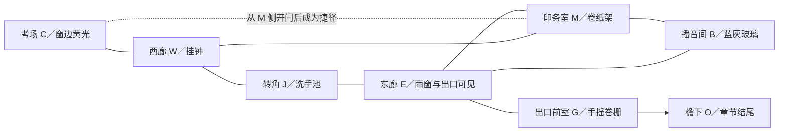
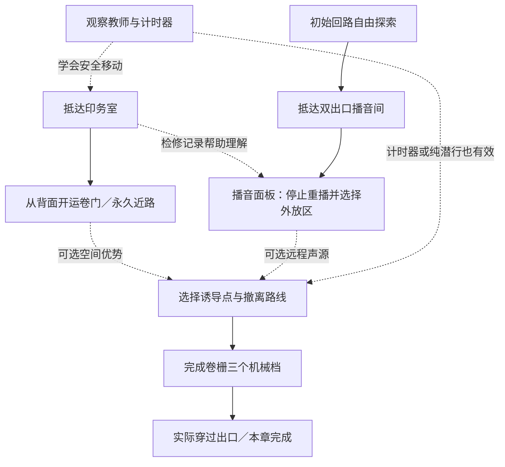

# DESIGN · 推荐方案 A「最后一遍铃」

方案 A 已于后续对话选定；2026-10-26 已有 A-M2.1 原型。本文保留设计目标，实际实现/验证以 PROJECT_STATUS 和 evidence/ACCEPTANCE 为准，尤其叙事演出、美术与时长尚未达到全部目标。

## 核心体验与范围

**从“不要被听见”到“让他听见我想让他听见的声音”。** 三个支柱：危险可读；声音具有双向用途；解谜让熟悉的空间获得新用法。详见 [方案比较](docs/CONCEPT_REVIEW.md)。

第一章是一段阴雨放学后的荒诞悬疑：一名学生、一名监考者、一段教学楼侧翼、三间核心房间和出口前室。首次游玩目标 15—25 分钟，暂不规定必须达到的最低时长。不做校园全景探索、多层楼梯、城镇、摩托车、战斗或随机地图。窗外庭院只是方向地标与结尾的小范围空间。

玩家约每 20—40 秒应做出一次可解释的选择：再观察一次还是移动；从明亮短路走还是经印务室绕行；把计时器留作诱饵还是带走；现在开近路还是等教师经过；继续抬栅还是先撤。这个频率是观察指标，不是强制事件计时器。

## 故事：考试已经结束，结束的声音却没有被允许出现

开场从坐在座位上开始，十秒内可自由观察和起身。自己的答题纸已经写完，其他桌面只剩收卷压痕；墙上钟还在走，广播却隔一段时间原样重复“离结束还有一分钟”。门没有神秘上锁。监考者在门外将空白试卷一张张摞齐。

在印务室，玩家看到同一份“终场通知”被覆印成“继续作答”，几摞试卷的修改痕迹完全相同；运卷门从背面被插上了闩。在播音间，循环播放开关被纸条固定，终场线路被切到本地监听。逐步认识：这不只是忘了打铃，而是一套不肯接受结束的日常秩序。

结尾由玩家自己的操作产生：停止重播，选一个远处的广播声源，打开出口卷栅，走到雨停后的檐下。脚步与铃声留在身后，眼前终于不是另一张要求继续作答的试卷。镜头保持可控，几秒安静后显示“第一章 · 已离场”。没有长篇解释谁是鬼；本章完成的是离开考场、拒绝无限继续作答。

允许熟练玩家绕过广播直接通过物理出口。章末完成条件是实际离场，不能用隐藏的“所有任务必须打勾”挡住已经打开的门。停止循环会让结尾的背景声真正安静；未停止时广播随距离自然淡出，同一结算，不另建多结局任务系统。

叙事信息分散为四处短读物/物件组合，每处核心文字以 1—2 句为限。追逐时不触发关键对白；已发现文本可在暂停的手册里回看。监考者只有短促反应声与动作，不在追逐中解释故事。

## 空间关系：先有一个可绕行的环，再让教室接入它

以下是**拓扑示意，不是按比例建筑平面图**。原型阶段再校准转角、开口和路程，不能将图上连线当成直线穿墙路径。

- **初始即有 W—J—E—M—W 回路。** 不能要求先解开谜题才获得第一次可执行的逃生路线。教师巡逻沿主回路，初始不主动进考场；因目击/声响可以进入。
- **C—M 是核心空间奖励。** 从 M 侧手动开闩后永久解锁，门扇仍可关上遮视线。玩家可回到熟悉考场设局；教师也能沿新连接调查，捷径不是永久安全通道。
- **B 有 M、E 两个出口。** 调广播时能看见东廊的一段，但教师也能透过明确可见的清玻璃看到站立玩家。柜体背面提供短暂停留的遮挡，不把整个房间标成无敌区。
- **G 不是长死胡同。** 卷栅操作点距可回撤转角约 3—4 米；前室有实体遮挡，玩家按一下就能中止操作。初始巡逻不在出口处长时间停驻。
- **C 内的低柜后是开场安全观察位。** 开场教师未被引入前可以学习和读短文本；追逐时不能躲进视线仍通的桌底就自动消失。桌面遮挡按真实高度计算。

初始尺度预算：可走室内约 180—240 平方米；考场约 8×7 米、印务室约 6×5 米、播音间约 4×3 米；主环约 35—45 米。走廊净宽 2.2—2.6 米、门洞净宽 0.95—1.1 米，净高 3.2—3.4 米。缩短行程优先于填更多内容，尺寸不是建筑测绘结果。

地标有重复视线联系：挂钟在 W；洗手池限定 J 的转折；印务室卷纸架形成黑白竖线；出口雨窗是冷色横向亮面。房名、声源线路标识和地图用同一称呼，不靠浮动箭头指路。

## 机制边界与玩家可学会的规则

### 1. 一只延时计时器

考场讲台上的机械考试计时器可拾取、放置、回收。第一版只支持落在合法平面上的确定性放置，不投掷、不滚落、不叠物。

暂定：启动后 3 秒预备滴答、8 秒铃声；一次只能有这一只计时器。启动可以在手持或放好后操作，手持响铃会暴露自己。可以停止、回收；不消耗次数。每次重新布置都需要接近它，选择的是位置和时机，不是刷消耗品。

教师听到有效铃声会转身、停步确认、走到声源位置调查。铃声停止也不会抹掉已经记下的调查位置。教师仍看得见玩家时，声音不能强制打断追逐。

### 2. 声音不等于透视

声音事件限定为步行/跑步、计时器、门闩/急关门、广播、卷栅链声。环境雨声和循环广播底声不作为不断重触发 AI 的事件。

声源按房间与开口连接传播。封闭墙体不靠单纯球形距离穿透定位；关门衰减，开门放大可达范围。清晰的大声源可确定到声源点；隔着关门的模糊声只把教师引到相应门口。音效混音与 AI 的可听性使用同一组事件及门状态，耳机不是强制需求。

首版不做精密声学模拟、声音掩蔽算法或“只要广播响，脚步就完全免检”。玩家看到/听到教师反应，才能知道诱导是否奏效。可选声音字幕仅描述实际可听事件及大致左右，不隔墙给敌人坐标。

### 3. 门与分段抬栅

普通门按 E 开关，有实体碰撞；关门能断视线，但教师会花约 1.2 秒开门后继续跟进。门不能无限撞晕教师或将其锁死。运卷门从 M 侧释放门闩一次后，解锁进度永久保留。

出口卷栅采用三个机械棘轮档，每档暂定需持续操作 2 秒。完成一档发出清楚的“咔哒”并保留高度；松手可立即撤离。初始开口 0m，三档暂定为 0.25m、0.70m、2.10m；前两档低于蹲姿净空，最后一档可站立通过。门体碰撞跟随实际位置，不在已经足够通过的开口留空气墙。无资源消耗、无自动落回；主要挑战是安排噪声与退路。

## 谜题与依赖：有空间推理，不是三把钥匙

| 节点 | 环境线索与可推导内容 | 玩家动作与即时反馈 | 后续变化 |
| --- | --- | --- | --- |
| P0 听懂巡视 | 门玻璃里的教师身影与同方向脚步；讲台计时器有清晰倒计时刻度 | 从安全观察位启动铃，看到教师停步转向；可以完全不用铃直接潜出 | 学会“声源吸引位置，视线确认目标”，不发钥匙奖励 |
| P1 运卷门的背面 | C 侧可见门缝后的闩与“运卷从印务侧开”；W/E 的门牌指向同一印务室 | 经主环进入 M，手动拉闩；门闩移动、教室暖光出现在开口 | C—M 新连接，下一次可从教师身后回到教室；同时扩大教师可达空间 |
| P2 把终场声送出去 | B 面板从左到右是播放源→监听/外放→分区；实际电线连续可追；试听灯会亮但走廊喇叭不响。M 的短检修记录解释“监听只进本机，外放依面板区域” | 停止循环带，改到外放，再选择 C/M/E 之一；按测试，面板相应指示与远处同名喇叭同步，错误状态可以随时撤回 | 获得可重复的远程诱导；终止“还有一分钟”的重播；不解锁无关门 |
| P3 让自己离场 | G 的棘轮图、链条和出口外自然光；已知教师会调查声音 | 决定声源与退路，分段抬栅；进度在机构上直接可见 | 出口真实开放，玩家实际通过才完成章节 |

P2 不要求分辨音高、听写旋律或色觉；线缆、文字、位置三重对应。不是任意开关组合：面板直接显示每一步的流向；重要问题是把声音送到**哪里对自己有利**。C 和 M 都是有效诱导目标，E 是近处风险选择。面板全在第一人称世界中可操作，长文查看才进入暂停界面。

实线表示物理操作前提，虚线表示知识/策略帮助。广播不以“读过检修记录”作为程序前置条件；玩家自行理解也能操作。捷径、广播均不作为隐藏通关勾选项。这是有推荐学习顺序的开放小章，而不是伪装成自由探索的任务链。

## 追捕循环与公平约束

| 状态 | 玩家读到的信号 | AI 使用的信息 | 玩家可执行的应对 |
| --- | --- | --- | --- |
| 巡视 | 规则脚步、查看卷纸/墙钟，拐角前身体先出现 | 固定路线与停留点 | 观察一轮，从身后通过；不用每次都制造诱饵 |
| 怀疑 | 停步、头部转向、短促“嗯？” | 部分视线或模糊声方向；不读玩家实际坐标 | 退回遮挡、停止跑动；怀疑逐渐消退 |
| 调查 | 朝声源行走、在声源前俯身检查 | 已记录的声源点或门口 | 从另一路离开；不要站在诱饵旁观察 |
| 追逐 | 明确短声提示、快步、身体转为前倾 | 可见玩家；断视线后只有最后目击点 | 过两次转角、关门争取时间，停止制造新声响 |
| 搜索/返回 | 减速、检查最后目击点及邻近门，随后恢复原脚步 | 最后目击点附近有限候选点 | 在遮挡后观察教师离开，再换路线；不能只靠原地蹲下消失 |

初始数值假设：教师巡逻 1.25m/s，追逐 4.3m/s；玩家走 2.6m/s、跑 4.5m/s、蹲 1.3m/s。无体力条。可见范围约 9m、前方夹角约 100°；清晰目击累积约 0.8—1.2 秒后追逐，贴身视线可更快确认但仍有反应声。近距离接触抓捕须同区域、距离满足、无遮挡，不隔门隔墙抓人。

断视线后向最后目击点行进约 2 秒，再检查最多两个邻近遮挡点，总搜索暂定 6—10 秒；没有新证据就返回。绝不在丢失视线后继续拿玩家当前位置寻路。蹲下改变胶囊与遮挡高度，不是固定比例的隐身魔法。

同一声源在本次调查尚未结束时不能反复延长调查；离开调查并回到巡逻后才接受新一轮。追逐优先于声音，新的清晰目击优先于旧声源；响铃结束不瞬间消除证据。规则固定、可观察，不加未提示的“用多了就永久免疫”。

在原型中不使用随机性；固定巡逻顺序便于学习和复现。只有在人工试玩表明过于机械且基础体验已成立后，才考虑有限停留差异，不能随机改变答案、出现位置或必经窗口。

教师完整走完路径，不能瞬移、无因冲刺、长期站在唯一出口。单次调查停留暂定不超过 6 秒；返回巡逻不将出口前室作为驻点。门口被挡需停止/重算并能转去其他可达点，不穿墙补偿。

## 第二次经过为什么不同

| 第一次 | 改变之后 |
| --- | --- |
| 考场是避风处，走出正门容易被看见 | 运卷门开放后成为布置诱饵与绕到背面的通道；教师也能从后门进来 |
| 印务室只是绕过长廊的遮挡 | 开近路后成为三方向决策点；卷纸架能让玩家再次断视线 |
| 广播是催促考试的压迫声 | 调通后由玩家选择响的位置，学校设施成为可用工具 |
| 出口链声意味着必须暴露很久 | 每完成一档，下次所需暴露时间更短，失败保留了空间进度 |

## 节奏目标（累计约 18—22 分钟的假设）

| 段落 | 首玩预算 | 情绪/选择 | 学习与空间变化 |
| --- | --- | --- | --- |
| 考场观察 | 0—3 分钟 | 熟悉中有异常；起身、试铃、观察门外 | 学声源与视线，操作可立即取消 |
| 首次出门 | 3—7 分钟 | 小幅紧张；短路还是绕过老师 | 认识 W—J—E—M 回路，早看到真实出口 |
| 印务室与近路 | 7—11 分钟 | 暂时缓和；读短线索、开背闩 | 拼回空间关系，完成第一次回访 |
| 播音间 | 11—16 分钟 | 主动实验；选择远程声源 | 从被广播控制到控制广播；安静让真实脚步更突出 |
| 出口行动 | 16—20 分钟 | 自主布置、可能撤退；短暂峰值 | 运用前面规则，分段进度确保重试有所得 |
| 檐下结尾 | 20—22 分钟 | 放松与结束 | 真实离场、环境声变化、简短结算 |

不能用强制等 30 秒、慢走长廊或多找一把钥匙来撑时长。若新玩家很快掌握且满意，可以更短；若迷路才达到 20 分钟，设计失败。具体触发调整的指标见 [验证计划](docs/VALIDATION_PLAN.md)。

## 失败、恢复与信息

被抓：短淡出后回最近已激活的合法检查点。初始为 C 窗边，开通近路后可启用 M 的遮挡后检查点。保存已开门闩、广播配置、已发现事实和卷栅档位。只重置本次追逐、暂态音源与角色位置；计时器回到玩家或检查点托盘，不留在不可达区。教师仅在明确重试淡出期间重置到相离的合法巡逻点，正常游戏中不瞬移；恢复后先有脚步提示与短保护窗口。

失败反馈来自实际最后证据，例如“链声引他到了门口；已升起的一档保留”。不报告未发现房间的解法，不虚构是因为玩家跑步。失败让玩家知道哪种声音危险、哪个转角仍然可见、哪段退路没留好；下一次能立即修改计划。

存档用稳定对象 ID 保存进度，写入独立 `user://` 目录；设置与进度分开。每次耐久变化自动保存，退出重进保留进度；读档回最近合法检查点，不恢复一个已经贴脸的敌人。损坏档回备份，不能悄悄擦档。关键状态应用须幂等。

手册区分“看到的事实”“玩家可尝试的推断”“尚未知晓”；未发现的广播线路不提前填答案。主动请求的提示分“观察哪里”“关联什么”“具体操作”三层，不自动连播。

## 质量底线

米制真实比例、完整天花板、可见边界与碰撞一致。站起前形状检查，低顶禁止强起；坠落回最近合法点。交互只显示准星方向、无遮挡、约 2m 内的一个目标；装饰灯不显示图标。暂停/手册互斥，释放鼠标并停止世界，关闭后只消费一次输入；危险中的抬栅等实体操作不中止世界时间。按钮、控制器状态和失焦恢复均需实测。

样板完成前不扩展全章美术。最终资产不能只是原色方块；门、桌椅、材质、教师动作、环境光都要在真实运行截图中检查。详见 [美术规范](docs/ART_DIRECTION.md) 与 [阶段验收](docs/VALIDATION_PLAN.md)。
