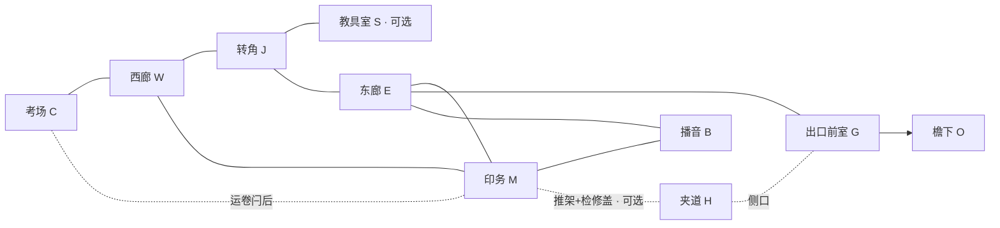

# 解谜 / 地图扩充 · 定稿（供排期）

- **日期**：2026-10-27（Asia/Shanghai）
- **角色**：情节机制 → @游戏开发 排期实现；**本 bot 不改游戏代码、不直接改 `DESIGN.md`**
- **提案源**：`/workspace/escape-exam-docs/design-proposal-puzzle-map-expand-20261027.md`（工作区提案；以本文为仓内自洽定稿）
- **协作**：`docs/COLLAB_CHAPTER01_IMPROVEMENT.md` · 房间代号见 `DESIGN.md`
- **分支**：`feat/chapter01-module-pass`

> **本文是定稿设计 + 实现清单，不是本轮代码 PR。** 地图扩充**不得**抢进代码 P0；先文档入库，由游戏开发按 P1/P2 切片开工。

---

## 0. ark 拍板（2026-10-27 · 已锁定）

| # | 开放问题（原提案 §10） | 决定 |
| --- | --- | --- |
| 1 | 侧室 **S 教具储藏** 是否挂在 J？ | **要做**；优先挂在 **转角 J**（洗手池旁侧门）。若现场景墙段不够，可改挂 W 近 J——实现前由开发目视场景确认，设计意图不变。 |
| 2 | 门楔强度 | **仅 peek（门缝窥视）+ 卡住已推移的卷纸架**。**禁止**楔住的微开门侧身通过。 |
| 3 | 夹道 **H 卷纸检修夹道** | **要做**；纯可选；**无 soft-lock**；不得成为离场硬前置或唯一生路。 |
| 4 | 雨窗曲柄 | **降为 P2**；不进本轮 / 不进 P1 必做包。 |
| 5 | S 短读是否占「约 4 处」 | 默认 **倾向少字**：S 柜可用纯视觉标签；若占用一读，须在改 DESIGN 时显式改四处名单（待改 DESIGN 时再定，不阻塞灰盒）。 |

**硬边界（重申）**：无垫时长钥匙；无第二敌人；无光级潜行；不重写教师五态；不重写通关骨架；主环保留。

---

## 1. 通关骨架挂接（不改写）

```text
计时器(P0) →（可选）运卷近路(CM / 原P1) →（可选）广播外放 → 三档卷栅 → 实际离场
         ↘ S 取楔：全程可选策略（窥视 / 卡架）
         ↘ 答卷堆标签：仅降低广播试错成本（无程序锁）
         ↘ 推架 + H：服务出口走位 / 撤退（可选）
         ↘ 雨窗曲柄：P2，服务链声分流（可选）
```

| 新增 | 挂接 | 可选？ | 保证 |
| --- | --- | --- | --- |
| S + 门楔 | 观察强化、门态策略、卡卷纸架 | 是 | **无楔可通关** |
| 答卷堆分区标签 | 广播空间推理 | 是（知识） | 无标签可试听试错 |
| 推架 + 夹道 H | 出口接近 / 撤退 | 是 | 主环 E→G 仍是正路；**不绕过抬栅** |
| 雨窗曲柄 | 出口噪声管理 | 是 · **P2** | 窗关亦可抬栅 |

章末完成条件不变：**实际穿过抬开的卷栅进入 O**。停止循环仍非硬前置。

---

## 2. 侧室 S「教具储藏」（P1）

| 项 | 定稿 |
| --- | --- |
| **位置** | **J 转角**侧门（优先）；备选 W 近 J |
| **尺度** | 约 3×4 m；新增可走合计与 H 一起建议 ≤40㎡ |
| **连接** | S ↔ J 单门；**不**直通 C/M/G |
| **巡逻** | 教师初始巡逻**不进** S；清晰目击/声响可跟入（与考场同构） |
| **用途** | （1）中段 rest 20–40s；（2）投放**唯一新道具门楔**；（3）隔离课：安全试卡门缝 |
| **对关键路径** | **纯可选** |

地标建议：半开铁皮教具柜、门牌「教具」、门内略暖小灯（仍几何视线，**不做光隐身**）。

---

## 3. 门楔（I1）· 强度锁死

| 项 | 定稿 |
| --- | --- |
| **发现** | S 教具柜内（或柜脚显眼处） |
| **用法 A** | 卡在普通门缝 → 门保持 **ajar**：玻璃剪影可读、声学按半开；**碰撞仍须完全开门才能通过**（**不可侧身挤过**） |
| **用法 B** | 卡住已推移的卷纸架，固定遮挡位，便于开检修盖（**楔非开盖硬前置**：无楔时架停在限位也可开盖） |
| **不是** | 第四把钥匙；不能锁死教师；不能无限免门声通过 |
| **噪声** | 放置/取出 = 弱门/道具类模糊事件（归入现有表） |
| **被抓恢复** | 楔回检查点托盘或 S 柜，不留不可达处；进度语义与 DESIGN 一致 |
| **教学** | 隔离：S 内储藏门试卡 → 组合：主环窥视 / 固定卷纸架 |

交互色沿用 ART 铜点族（`#B78C48` 量级）；禁止柜内再藏「真钥匙」。

---

## 4. 夹道 H「卷纸检修夹道」（P1）

| 项 | 定稿 |
| --- | --- |
| **路径** | M 卷纸架墙后 → 短夹道（净宽约 0.9–1.1 m、长约 6–8 m）→ **G 侧壁检修口** |
| **发现** | 推开卷纸架（限位约 0.8–1.0 m）→ 交互检修盖打开 |
| **对关键路径** | **纯可选捷径**；只改「如何到抬栅点 / 如何撤」，**绝不替代三档抬栅** |
| **可逆** | 盖板建议可开可关；至少保证 **G→M 可出**，禁止不可提示单向困死 |
| **教师** | 盖开形成 portal；可被声诱调查；**可进入 H**（公平：靠噪声与窄道，不靠 AI 豁免）；初始巡逻不把 H 作驻点 |
| **失败预期** | 盖板声引来调查；H 内被跟入须退 M 或冲 G——**H 不是唯一逃出生天** |

发现线索（非语言优先）：架座刮痕朝墙缝、墙裙色差/散热孔、检修盖铜点准星。

---

## 5. 雨窗曲柄（E）· **P2 only**

| 项 | 定稿 |
| --- | --- |
| **排期** | **P2**；P1 不做、不挡 S/H 验收 |
| **动作** | 一档开/关，可撤回；不能爬出窗外 |
| **效果** | 声学 portal（室内大声源更易引到东廊窗前）；雨床局部略响且**不进** AI 事件表 |
| **噪声** | 摇窗本身 = 清晰门/机关类事件 |
| **禁止** | 光隐身；庭院关卡化 |

---

## 6. 其它可选物化（随 P1，非新锁）

- **答卷堆（M）**：短位移露出分区标签，与 B 面板 / Speaker 名一致；**无「读过才能 test」程序锁**。
- **可推卷纸架**：与 agent-plan「可推遮挡」合一；同时是 H 的发现条件。

---

## 7. 扩充后拓扑（示意）



刻意不做：二层、庭院可走区、第二考场、厕所迷宫、多办公室、整章重绘。

---

## 8. 实现清单（给 @游戏开发）

> 路径相对 `EscapeExamGodot/`。**无本文附带补丁代码。**

### P0 · 文档（本提交）· **已完成 / 勿抢代码**

- [x] `docs/PLOT_P0_BEATS_AND_FAIL_LINES.md` — 节拍表 + 失败证据句
- [x] `docs/PLOT_PUZZLE_MAP_EXPAND.md` — 本定稿（S / 楔 peek+卡架 / H / 雨窗 P2）
- [ ] （可选后续）把下列「建议措辞」经 ark 过目后写入 `DESIGN.md` — **非本 bot 本轮职责**

**代码 P0 不包含**灰盒 S、门楔、H、雨窗。氛围 / 警戒可读 / 夹具不回归仍按 COLLAB §5 其它条目，与本扩充正交。

### P1 · 实现包（排期主切片）：**S + 门楔（peek/卡架 only）+ 推架 + H**

约 2–4 人日量级（视场景墙段与导航而定），建议顺序：

1. **灰盒 S**：`chapter_01.tscn` 于 J 增房间与门；导航重烤；`patrol_points` 不含 S。
2. **门楔**：拾取 / 放置 / 回收；仅合法门；**ajar = 视线+声学，不可侧身通过**；状态进存档；被抓恢复不丢进度语义。
3. **可推卷纸架**（若未做）：限位 ~1 m；挡 LoS；不堵死 M 出口。
4. **检修盖 + H + G 侧口**：双向可走；开合发声进 acoustics；教师可调查进入；无导航穿墙。
5. **答卷堆滑动 → 分区标签**（Label3D 即可）。
6. **验收门禁**：
   - 无楔、不进 S、不推架、不开盖 → 骨架通关仍 PASS
   - 有楔可稳定窥视一轮；不可挤过 ajar 门
   - 开盖声能引教师；H 内无 soft-lock；夹具不因新空间红片

### P2 · 雨窗曲柄与出口组合手感

约 1–1.5 人日：

1. 雨窗一档开合 + portal + 床声局部（不进 AI）
2. 人工听：链声在窗开时分流是否可读
3. 验收：可撤回；熟练路线不被强制拉长；一次「远端诱饵 ± H ± 抬栅」人工手感

### 明确不做

- 重写 `teacher.gd` 状态机；第二敌人；光级侦测；庭院关卡；多钥匙；对话树；整章 `author_scene.py` 再生；楔侧身通过。

---

## 9. 建议写入 `DESIGN.md` 的措辞（**未应用**）

> 仅草稿；由 ark / 游戏开发决定何时合入 `DESIGN.md`。情节机制 bot **不**直接改该文件。

### 空间关系 · 建议插入句

> 转角 J 可设教具储藏侧室 S，用于安全习得门楔（门缝窥视与固定卷纸架；楔住的门不可侧身通过）。印务卷纸架后可经检修盖进入夹道 H，连至出口前室侧口。二者均为可选，不改变 W—J—E—M 初始回路与卷栅离场条件。

### 谜题与依赖表 · 建议增补行

| 节点 | 要点 |
| --- | --- |
| P1b 门楔与窥视（可选） | S 取楔；ajar 只改视线/声线；可卡卷纸架；非离场前置 |
| P2 行补 | 答卷堆标签强化空间推理（无程序锁） |
| P3 行补 | 可选夹道接近/撤退；可选雨窗声线分流（P2 实现） |

### 机制边界 · 建议短小节标题

- 「门楔 / 检修盖 /（P2）雨窗曲柄」：噪声 kind、可撤回、非硬前置、H 非无敌区。

### 「第二次经过为什么不同」· 建议加行

| 第一次 | 改变之后 |
| --- | --- |
| 印务卷纸架只是遮挡 | 推架后成为暗道发现器；可选进入 H |
| 东廊雨窗只是地标 | （P2）可开后成为声线阀 |

### `PROJECT_STATUS.md` · 建议追加（未落地前勿写入「已实现」）

> 情节机制已提交定稿 `docs/PLOT_PUZZLE_MAP_EXPAND.md`：S+门楔（peek/卡架）、夹道 H 为 P1；雨窗曲柄为 P2。通关骨架与教师五态不变。待游戏开发按清单实现。

### `docs/KNOWN_ISSUES.md` · 建议风险条

> 若门楔/暗道被做成离场硬前置，将违反「禁止加锁凑时」；验收须保留无楔无暗道通关路线。楔若允许侧身过门，视为平衡回归，需 ark 重批。

---

## 10. 给排期的一句话

**P1（游戏开发下一实现包）= S 教具室 + 门楔（仅 peek / 卡架）+ 推架 + 夹道 H；P2 = 雨窗曲柄。** 全部可选、无 soft-lock、无垫钥匙；代码勿抢进氛围/可读性 P0。

---

## 11. 源提案指针

完整论证与开放问题原文见工作区：

`/workspace/escape-exam-docs/design-proposal-puzzle-map-expand-20261027.md`

**仓内以本文为准**（已合并 ark 锁）；避免实现同学只读未拍板提案。

---

*定稿结束。实现请按 §8；DESIGN 合入请用 §9 草稿经 ark 确认。*
