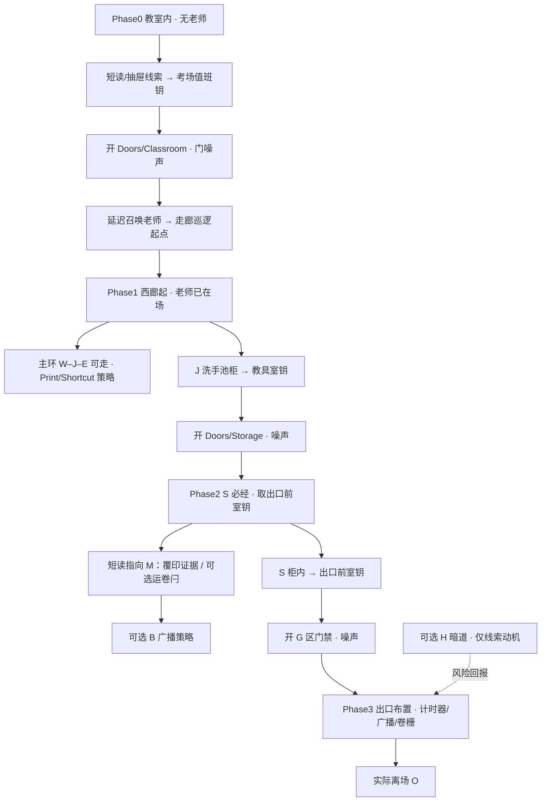
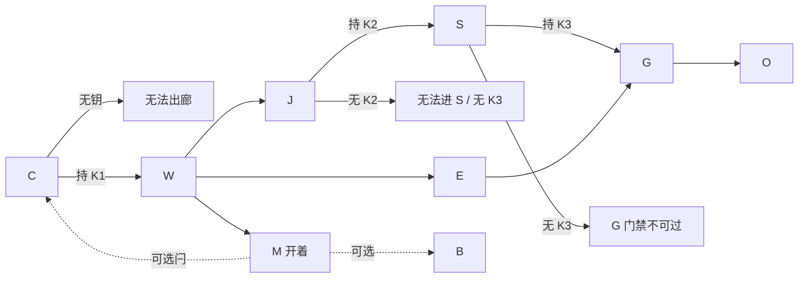

# 第一章推进环重设计 · 教室禁锢→钥匙链→开门招老师

- **状态**：**设计「用户已批准」**最小钥匙链 · ark · 2026-10-28（Asia/Shanghai）· **代码已落地** feat tip `9121693209ffa42a67c576b47b87ebedb7559978`（FF · `feat/chapter01-gated-min-keychain` / `feat/chapter01-module-pass`）· **体验未 PASS** · **未合 main** · 本策划文件**不改** `.gd` / `.tscn` / `DESIGN.md` 正文
- **落地戳**：2026-10-28（Asia/Shanghai）· schema2 `keys` {k1,k2,k3} · `doors_unlocked` {classroom,storage,gateantechamber} · `teacher_summoned` · **G·K3 锁定** `Doors/GateAntechamber`（**不是** Gate/Handle）
- **日期**：2026-10-28（Asia/Shanghai）
- **角色**：情节 / 机制 / 关卡策划（EscapeExamGodot · Godot 4.7.2 · 章 A-M2.1）
- **对照**：`DESIGN.md` · `docs/design/SPACE_UNLOCK_AB.md` · `docs/design/CHAPTER01_BEATS_10_15.md` · `docs/design/CHAPTER01_GATED_IMPL_CARD.md` · `docs/design/DESIGN_HARD_SENTENCE_PATCHES_GATED.md`
- **技能**：`level-design`（教→练→考 · 关键路径校验）· `godot-genre-stealth`（门噪声 · 路径听力 · 渐进危险）· `godot-genre-puzzle`（隔离引入→组合 · 防 soft-lock）
- **征询**：游戏开发 / 游戏审核（2026-10-28）· **征询意见 ≠ 实现承诺** · 实现须等游戏开发排期

---

## 「用户已批准」· 最小钥匙链（ark · 2026-10-28 Asia/Shanghai）

### 落地状态（feat merge 后 · 2026-10-28 Asia/Shanghai）

| 项 | 状态 |
| --- | --- |
| **设计** | 「用户已批准」最小钥匙链（不变） |
| **代码** | 已实现并 FF 至 feat tip `9121693209ffa42a67c576b47b87ebedb7559978` |
| **G·K3 节点** | **已锁定** `Doors/GateAntechamber`（否决 Gate/Handle 挂锁） |
| **Progress** | schema2：`keys` {k1,k2,k3}；`doors_unlocked` {classroom,storage,gateantechamber}；`teacher_summoned` |
| **体验** | **NOT PASS**（未宣称章节体验验收通过） |
| **main** | **未合** |

**已知缺口（非阻塞 · 不挡 feat 留存；须跟进）**

1. `route_trial.gd` **尚未**按 gated 开场重定向 / 作废旧「开场即环」假设。
2. 锁门时 **navmesh hole cut**（锁门导航洞）**未做**。
3. 体验验收 **NOT PASS**；**未合 main**。


> Widget 原文：「批准最小钥匙链：C出廊硬锁 + K1/K2/K3，S必经，老师开门后延迟上场」

### 已批准（产品方向 · **代码已在 feat 落地**；main / 体验验收仍开放）

| 项 | 批准内容 |
| --- | --- |
| **主方案** | **C 出廊硬锁 + K1 / K2 / K3** · **S 必经** · 老师在**首次打开教室门后**延迟上场于**走廊巡逻起点**（**禁止**瞬移进教室） |
| **主环** | **W–J–E 大体可走**（最小冲击；不层层锁主环） |
| **非钥系统** | Print / Shortcut / 广播 / 运卷闩 **不**改成钥匙；**M 软牵引**靠短读；**B / H 可选**；**H 仅线索动机** |
| **钥进度** | 钥进进度、**被抓保留**；**禁止**钥落锁死房内 soft-lock |

### 仍待定（设计默认 · 待 ark 覆盖 · **不是**新批准）

下列为 **SAFE DEFAULTS**，文档化为设计默认，**不等于** widget 新勾选批准；ark 可日后覆盖。

| # | 开放项 | 设计默认（仍待定） |
| --- | --- | --- |
| D1 | Phase0 误响计时器 / 铃 | **不召唤老师**（远应一声仍不上场 OK——若音频已有设计可保留；**无召唤**） |
| D2 | M · `Doors/Print` | **保持可开**（不硬锁） |
| D3 | 对外时长口径 | **保持**先前已批熟练 **10–15** / 首玩 **15–25**，直至试玩；gated 可能把首玩推向 **18–28** 仅作 **待测假设**，**不是**新批准时长 |
| D4 | H 暗道 | 保持 §7 线索包装 · **可选** |
| D5 | G 区 K3 锁节点 | **已锁定** · `Doors/GateAntechamber`（**不是** Gate/Handle）· 游戏开发 · feat tip `9121693…` |

### 明确未选（本票）

- **半锁（仅出教室）** — 未选
- **维持 A**（撤销重开、继续自由回路为产品方向）— **未选**（A 降为**当前代码历史基线**，见 `SPACE_UNLOCK_AB.md` 2026-10-28 重开横幅）
- **搁置整题** — 未选
- **混合（M 也硬锁）** — 未选（默认 Print 可开）

---

## 0. 变更声明（ark 重开）

### 0.1 被推翻 / 被重开的先前锁定

| 先前锁定 | 出处 | 本提案态度 |
| --- | --- | --- |
| **方案 A · 自由回路**（开场即可走 W–J–E–M；封闭感用观察/声/失败句软做） | `SPACE_UNLOCK_AB.md` · ark **「用户已批准」** 2026-10-27 | **已被 2026-10-28 最小钥匙链产品方向取代**；A 仍是**当前代码**历史基线，直至游戏开发落地 gated；**未改代码 / 未改 `DESIGN.md` 正文**（改写句见 `DESIGN_HARD_SENTENCE_PATCHES_GATED.md`） |
| **硬 B1**（教室/主环硬锁 + 逐层解锁）曾被明确否决 / 不推荐 | 同上 | **已落为「最小冲击」钥匙链（已批）**，**不是**把整主环每扇门层层上锁的旧 B1 |
| B2 / B3 | 未选 / 搁置 | 本票**未**选半锁 / 维持 A / 搁置；混合（M 硬锁）未选 |

### 0.2 本提案主张什么（**已批准为产品方向** · **代码已在 feat 落地**）

玩家体验优先（ark 2026-10-28 口述，经整理）：

1. **开场不要解锁整张地图**——先禁锢在教室 **C**。
2. **老师一开始不出场**。
3. 在教室内找**线索**，拿到开门钥匙，才能进走廊。
4. **开门不能太便宜**：开门发声，会招老师。
5. 后续门需要在**走廊与邻房**找到对应钥匙；**不能跳步**；**每个房间最好都用到**。
6. 暗门 / 暗道可以有，但必须由短读物 / 物件动机驱动——**禁止为暗门而暗门**。

### 0.3 落点：「最小冲击」钥匙链（**「用户已批准」** · 2026-10-28）

综合玩家口述 + 游戏开发可行性 + 审核风险，本文**已批准落点**：

> **C 出廊硬锁 + K1/K2/K3 有动机钥门**（教室正门 → 教具室 S → 出口前室 G 区），**主环 W–J–E 大部分仍可走**；**不要**每扇门一把钥；**不要**把整主环层层锁死。

几何拓扑可不动；老师在**首次成功打开教室门后延迟到场于走廊巡逻起点**（禁止瞬移进教室中心）。**代码已落地** feat tip `9121693…`；**体验未 PASS** / **未合 main**。

### 0.4 硬边界（除非 ark 日后另批）

- 无第二敌人；不扩 Unity 大校园；无对话树；叙事靠短读物 / 道具。
- 本 bot **只出设计文档**；实现交游戏开发，且须另批。
- **禁止无意义垫钥 collectathon**：钥匙必须有动机、数量少（**≤4，本默认 3**）。
- **保留**计时器 / 广播 / 三档卷栅 / 运卷闩系统；只重接 **何时老师上场** 与 **哪几扇门初锁**。
- H 保持**可选**（除非另有文件动机硬改）；本默认建议 **S 改为必经**。

---

## 1. 体验目标与非目标

### 1.1 体验目标（玩家感受）

| # | 目标 | 玩家怎么感到 |
| --- | --- | --- |
| T1 | **渐进展开的楼** | 先困在熟悉考场 → 第一次开门是仪式 → 走廊像「世界突然变大」 |
| T2 | **老师出场有因果** | 不是开局就在门外晃；是「我开了那扇门」才把秩序叫来 |
| T3 | **开门是风险，不是免费传送** | 每把有意义的钥匙门伴随噪声 / 暴露窗；诱饵（计时器 / 广播）仍是对策 |
| T4 | **教→练→考** | Phase0 安静学线索；Phase1 第一次噪声+老师；Phase2 钥门+绕行；Phase3 出口布置用齐学过的声线 |
| T5 | **房间有事可做** | 关键路径碰到的房都给「为何必须来」；可选房给风险回报，不假装必做 |

### 1.2 非目标

- 不做 RE2 式整栋楼多钥迷宫；不做钥匙墙。
- 不做战斗、第二敌人、对话树、黑箱「老师忽然会开门」。
- 不把广播 / 运卷闩改成硬通关勾选项（仍可作**策略优势**）。
- 不宣称本提案已改代码或已通过验收。
- 不用「多找一把钥匙」单纯撑时长（见 `DESIGN.md` 质量句；本钥链服务于节奏与动机，不垫时）。

---

## 2. 阶段推进图

### 2.1 总览（Mermaid）



### 2.2 ASCII 简图

```
Phase0  [C 禁锢][老师未上场]
          | 线索 → Key1 考场值班钥
          v
        开 Classroom（噪声）──延迟──> 老师出现在走廊巡逻起点
          |
Phase1  [W]──[J]──[E]     ← 主环大部分可走（最小冲击）
          |    |
          |    +─ Key2 教具室钥（洗手池柜）
          v
Phase2  [S 必经] → Key3 出口前室钥
          | 短读「底稿在印务」→ 鼓励进 M（叙事/近路；非第四把钥）
          | 可选 B 广播
          v
        开 G 区门禁（噪声）
          |
Phase3  [G] 三档卷栅 + 诱饵布置 → [O] 离场
          ^
          └─ 可选 H（线索指向才存在价值）
```

### 2.3 阶段一句话

| Phase | 玩家在干什么 | 老师 |
| --- | --- | --- |
| **0** | 在 C 观察异常、读短文、找钥；可练计时器放置（铃可先不响，或响了也「暂时无人应答」——见 §5） | **未上场** |
| **1** | 第一次出门；学习「开门=声线」；认 W–J–E；取 Key2 | **已延迟到场**，开始巡逻 / 可被噪声吸引 |
| **2** | 进 S 取 Key3；回访廊与 M/B 做策略；准备出口 | 正常五态 |
| **3** | 开 G 区后布置诱饵、抬栅、离场 | 出口噪声高峰 |

---

## 3. 每房必用表

约定：**必经** = 关键路径硬前置；**强烈建议** = 叙事 / 策略完整度高但程序可不挡通关；**可选** = 风险回报侧翼。

| 房 | 本提案角色 | 为何必须来 / 为何可省略 | 线索 / 道具动机（已批方向 · 文案可微调） |
| --- | --- | --- | --- |
| **C** | **必经** | 起点；Key1；计时器所有权；开场观察窗 | 答题纸已写完；广播「还有一分钟」；抽屉/讲台侧柜短条：「值班钥放回讲台第三格」等 |
| **W** | **必经** | 出教室后的第一段廊；挂钟地标；老师巡逻可读段 | 门开后走廊声场；墙钟与「巡视路线」便签 |
| **J** | **必经** | **Key2** 获得地；转角教学（视线/声） | 洗手池下检修柜贴条：「教具室备用钥 · 勿带离本层」 |
| **E** | **必经** | 早看见雨窗 / 出口亮面（动机）；通向 G 的最后廊段 | 雨窗冷光；G 向门禁可见但初锁 |
| **M** | **强烈建议**（默认不硬锁 Print） | 覆印叙事核心；运卷闩可选近路；广播知识入口 | S 内短读指向「终场通知底稿在印务」；W/E 门牌仍指同一印务室 |
| **B** | **可选策略** | 远程诱导；停循环改听感 | 面板可撤回；**不**作通关勾选（兼容现骨架） |
| **G** | **必经** | Key3 门禁后的卷栅操作；章节机械高潮 | 棘轮图、链条、外光；门禁旁「闸前钥由教具室保管」 |
| **O** | **必经** | 实际离场结算 | 雨后檐下；「第一章 · 已离场」 |
| **S** | **必经（本默认改）** | **Key3**；门楔可仍作额外教学 | 「教具」门牌；柜内钥挂牌 + 短读指 M；门楔可继续可选捡 |
| **H** | **可选** | 无硬前置；暗道仅当短读/物件指向时提供捷径或额外诱饵点 | 见 §7；找不到必须有绕过 |

> **与「每房最好都用到」的张力（写给 ark）**：若坚持 **M/B 也硬必经**，会逼近开发不建议的「整环层层锁」，并与「广播非硬前置」冲突。本默认用 **S 硬必经 + M 强烈建议（短读牵引）+ B/H 可选** 折中；若 ark 要求 M 也硬锁，改把 Key3 改为「开 `Doors/Print`」，G 仅靠卷栅噪声门禁——见决策票。

---

## 4. 钥匙 / 线索清单（默认 3 ≤ 4）

| ID | 名称（暂定） | 获得地 | 打开什么 | 丢失 / 被抓是否保留 | 防 soft-lock |
| --- | --- | --- | --- | --- | --- |
| **K1** | **考场值班钥** | C：讲台抽屉 / 第三格柜（短读指向） | `Doors/Classroom`（C→W） | **进度永久**：进 `Game.progress`；被抓不丢；检查点保留 | K1 只在 C 内可取；C 始终可达（起点 / 检查点）；取走后抽屉空态可读 |
| **K2** | **教具室钥** | J：洗手池下柜 | `Doors/Storage`（进 S） | 同上，永久 | 仅在已出 C 且老师已上场后的可走廊获取；J 不锁死；被抓回 C 后钥仍在包里，可再出（Classroom 已解锁保持开锁进度） |
| **K3** | **出口前室钥** | S：教具柜挂牌 | **`Doors/GateAntechamber`**（G 区门禁 · **已锁定**；**不是** Gate/Handle） | 同上，永久 | S 在持 K2 后可达；K3 不放在 G 锁后门后；无「钥落锁内房」 |

### 4.1 明确不做的第四钥

- 不为 `Doors/Print`、`Doors/Shortcut`、Hatch、广播柜再各做一把钥。
- 运卷闩 **不是钥匙**：仍是 M 侧一次性空间奖励。
- 门楔 **不是钥匙**：可选。

### 4.2 Soft-lock 总规则（puzzle 技能对齐）

1. 钥匙进进度字段后 **永不因被抓删除**。
2. 门解锁进度 **永久**（对齐现有 shortcut 闩哲学）。
3. 禁止「钥在锁死房内且无第二入口」。
4. 半链存档：读档须幂等恢复 `keys[]` + 各门 `unlocked` + 老师是否已召唤（见 §10 / 征询）。
5. 关键路径图必须通过「可达性闭包」检查（§8）。

---

## 5. 门噪声规则

对齐 stealth：**路径长度听力**（非裸 `distance_to`）、渐进调查，而非开门即瞬抓。

### 5.1 哪些交互发声（待调数值）

| 交互 | 噪声等级（草案） | 老师反应（已上场后） |
| --- | --- | --- |
| 普通门轻开 / 轻关 | 低 · 模糊 | 若路径近：怀疑停步 / 看向门口 |
| **钥匙门首次解锁 + 推开** | **高 · 清晰** | 记录声源点或门口；进入调查 |
| 急开门 / 急关门 | 中高 | 同现 DESIGN 门声 |
| 运卷闩拉起 | 中 | 同现逻辑 |
| 计时器铃 | 高（既有） | 调查声源点 |
| 广播外放测试 | 高（既有） | 分区吸引 |
| 卷栅链 / 档位咔哒 | 高（既有） | 调查 G 向 |

### 5.2 首次出教室如何「召唤」老师（关键）

**已批准路径**（召唤时机）：

1. Phase0：场景内 **无老师实例激活**（或禁用 AI / 移出导航），玩家在 C 内安全学线索。
2. 玩家用 K1 **成功解锁并完成第一次打开** `Doors/Classroom`。
3. 播门噪声（玩家可听见金属弹子 / 廊回声）。
4. **延迟**（草案 2.5–4s，待测）：在 **走廊巡逻起点**（W 或既有 patrol 第一点）**生成 / 启用**老师，播远处脚步，**禁止**瞬移进教室中央。
5. 若玩家立刻退回 C 关门：老师仍在廊侧调查「那扇门」，形成第一次可读压力——而不是开局贴脸。

Phase0 若误响计时器：**仍待定 · 设计默认 = 不召唤老师**（本地声 OK；远应一声仍不上场 OK；**无召唤**）。避免跳过开门仪式。

### 5.3 与诱饵听感的区分（审核盲测点）

- 开门噪声 = **短促机械音** + 门扇；调查点偏 **门口**。
- 计时器 = **铃节律**；调查点偏 **铃放置点**。
- UI 仍关闭 Alert 时：靠脚步变化 / 停步 / 俯身区分；失败句须能说清「是门声还是铃声」（拟实现，挂失败卡）。

---

## 6. 与现骨架兼容

| 系统 | 挂接方式（已批 · feat tip `9121693…`） | 仍可选？ |
| --- | --- | --- |
| **延时计时器** | Phase0 可拿可练；Phase1+ 仍是主诱饵 | 策略可选（可纯潜行） |
| **广播** | 仍不锁门；Phase2/3 远程诱导 | **保持可选策略** |
| **运卷闩 C↔M** | 仍从 M 侧开；建议在持 K1 且老师上场后才有战术意义 | **保持可选空间优势** |
| **三档卷栅** | Phase3；须先过 G 区 Key3 门禁 | 通关硬步骤（既有） |
| **门楔** | S 内仍可教 peek / 卡架 | 可选 |
| **H 夹道** | 可选捷径；教师共享风险 | 可选 |

**开发建议采纳（征询）**：保留 `timer → (可选) broadcast → gate` 骨架；只把 **出教室 / 进关键房** 改成钥匙门——本文默认正是此路径。

---

## 7. 暗门 / 暗道（最多 1 个）

| 项 | 内容 |
| --- | --- |
| **候选** | 既有 **H**（`HatchM` ↔ `HatchG` / `MaintenanceH`）升格为「唯一暗道」叙事包装 |
| **动机（必须先有）** | M 内检修短读或 S 内教具清单一句：「雨天漏电时走夹道检修，盖板在印务地台 / 闸前地台」 |
| **禁止** | 无文字 / 物件指向的隐藏刷墙；第二套暗门；暗道藏 **唯一** K3 |
| **找不到时** | **必须可绕过**：主环 W–J–E–G（持钥后）完整可通；H 只缩短暴露或给额外放置点 |
| **Soft-lock** | 禁止 | H 内不放不可替代钥；盖板卡死须可从另一侧或主路放弃 |

---

## 8. 防跳步

### 8.1 钥匙顺序图（校验用）



闭包检查（level-design `goal_reachable` 思路）：

- 仅 Start → 不可达 O。
- Start+K1 → 可达 W/J/E/M/B，不可达 S 内 K3 所护的 G 完成态（若 G 硬锁）。
- +K2 → 可达 S。
- +K3 → 可达 G 操作 → O。

### 8.2 熟练捷径：允许 / 禁止

| 允许 | 禁止 |
| --- | --- |
| 已知位置秒取 K1/K2/K3 | 未开门禁就 clip / 调试传送出 C |
| 跳过广播、跳过运卷闩、跳过 H | 跳过 K1 出廊；跳过 K3 进 G 操作 |
| 用计时器 / 广播优化老师位置 | 把钥匙扔进不可达区且进度未记账 |
| 开闩后战术回访 C | 半锁存档丢失钥却门已锁回 |

---

## 9. 节拍粗估（假设 · 非试玩结论）

先前口径（`CHAPTER01_BEATS_10_15.md`）：熟练 **10–15** / 首玩 **15–25**（双档，「用户已批准」时长口径）。

| 档 | 对本 gated 默认的判断（**假设**） | 建议 |
| --- | --- | --- |
| **首玩** | Phase0 找钥 + 第一次开门仪式约 **+2–5 min**；S 必经约 **+1–3 min**；总长易靠向 **18–28 min** | **仍待定**：对外**保持**已批 **15–25**；**18–28 仅为待测假设**，不是新批准时长 |
| **熟练** | 知点位可压到 **12–18 min** | **仍待定**：对外**保持**已批 **10–15**；12–18 为待测假设 |
| **风险** | 钥门+噪声若挫败，时长来自卡关而非乐趣——失败 | 须盲测；禁止靠加钥撑时 |

> 所有 gated 分钟数为 **待测试假设**，不得写成已人工验证；**不得**把 18–28 / 12–18 写成「用户已批准」时长。

---

## 10. 实现任务清单（仅条目 · 无代码）+ 审核关注点

### 10.1 交给游戏开发（批准后）

1. 扩展 `door.gd`：仿现有 `locked` / 进度；增加 `key_id`（或等价）与进度字段 `keys` / `doors_unlocked`。
2. 初锁：`Doors/Classroom`、`Doors/Storage`、G 区门禁（节点确认）；**不**初锁整环。
3. 世界放置 K1/K2/K3 交互物 + 短读物指向。
4. 开门噪声 → `hear_noise`（路径听力）；钥匙门首次解锁放大等级。
5. 老师延迟到场：首次 Classroom 打开后 → 走廊巡逻起点启用；Progress 记 `teacher_summoned`。
6. 存档读写幂等；被抓保留钥与门进度。
7. Phase0 计时器与「未召唤」策略按决策票实现。
8. 导航链接：锁门时禁用 `NavigationLink3D`（对齐 Shortcut 既有模式）。
9. 最小门表与开发对照（§12）；夹具分层见下。
10. **不**改广播硬前置；不改卷栅三档语义。

**开发征询摘要（非承诺）**：几何拓扑可不动；教室锁 + 2～3 钥 + 开门→`hear_noise` ≈ **1–2 人日最小切片**；最易炸：钥匙 soft-lock、progress 与门锁/导航/到场不一致、**教师延迟到场比门锁更易炸夹具**。

### 10.2 审核关注点

| 层级 | 关注 |
| --- | --- |
| **高废风险夹具** | Initial route / shortcut-from-classroom / `route_trial`（开场即环假设失效） |
| **中风险** | 「无楔离场」与「每房必用 / S 必经」叙事冲突——验收文案要改 |
| **盲测怕** | 钥落锁回房；开门噪声钉死老师且无第二诱饵；双钥无提示；半链存档；跳步捷径；开门声与铃声听感混淆 |
| **分层验收** | **acceptance ≠ 体验**：需 **关键路径门禁夹具** + **人工盲测**；自动化只保证可达与进度，不保证「好不好玩」 |

---

## 11. 决策票给 ark（回写 · 2026-10-28 Asia/Shanghai）

- [x] **批准「最小钥匙链」本默认**（C 出廊硬锁 + K1/K2/K3 · S 必经 · G 区第三钥 · W–J–E 大体可走 · 老师延迟到场）← **「用户已批准」** · ark · 2026-10-28 · **代码已落地** feat tip `9121693…` · **体验未 PASS** · **未合 main**
- [ ] **半锁（仅出教室）**：只锁 `Doors/Classroom` + K1 + 开门招老师；S/G 不硬锁钥 ← **未选**
- [ ] **维持 A**：撤销本次重开，继续自由回路（`SPACE_UNLOCK_AB.md` 2026-10-27）← **未选**（A 降为当前代码历史基线）
- [ ] **混合**：最小钥链 + 要求 **M 也硬锁**（K3 改开 `Doors/Print`，G 不再单独钥）← **未选**
- [ ] Phase0 误响计时器：**不召唤老师** / **远应一声仍不上场** / **直接召唤** ← **仍待定** · 设计默认 = **不召唤老师**（远应一声仍不上场 OK）
- [ ] 首玩时长口径：保持 15–25 / **改为 18–28（待测）** / 其他 ← **仍待定** · 设计默认 = **保持**已批 10–15 / 15–25；18–28 仅待测假设
- [ ] H 暗道：按 §7 包装 / 本版完全不提暗道 ← **仍待定** · 设计默认 = **按 §7 · 可选**
- [ ] 搁置整题，维持代码不动 ← **未选**

**G 区 K3 锁节点** ← **已锁定** · `Doors/GateAntechamber`（**不是** Gate/Handle）· 游戏开发 · feat tip `9121693…`（见 §14 / 实现卡）。

---

## 12. 工程 / QA 征询摘要

> 以下为 2026-10-28 向 **游戏开发**、**游戏审核** 征询的归纳，**不是排期承诺，不是验收通过**。

### 12.1 游戏开发

- 拓扑可不动；最小切片：教室门锁 + 2～3 钥 + 开门 `hear_noise`。
- 仿现有 `door.locked` / 进度模式扩 `key_id`。
- 炸点：soft-lock；progress 与门 / 导航 / 老师到场不同步；**延迟到场夹具**。
- 建议：保留 timer→(可选)broadcast→gate；只锁出教室与关键房。
- 可另要「最小门表」对照 `Doors` 节点名 → 见下表。

### 12.2 游戏审核

- 高废：Initial route、shortcut-from-classroom、`route_trial`。
- 中：无楔离场表述 vs 每房必用。
- 盲测怕：钥锁闭环、门声钉老师、提示不足、半链存档、跳步、门声/铃声混淆。
- 验收分层：acceptance ≠ 体验；要关键路径夹具 + 人工盲测。

### 12.3 最小门表草稿（对照 `scenes/chapters/chapter_01.tscn`）

| 节点 | 现况 / 基线 | 已批准落地（feat tip `9121693…` · **体验未 PASS**） |
| --- | --- | --- |
| `Doors/Classroom` | 普通门实例 | **初锁** · 需 **K1** · 首次打开触发老师延迟召唤 + 高噪声 |
| `Doors/Storage` | 通 S | **初锁** · 需 **K2** · 开锁噪声 |
| `Doors/Print` | 通 M | **保持可开**（**仍待定默认** = 不硬锁；混合票未选） |
| `Doors/Shortcut` | `is_shortcut` · 进度闩 | **不改钥**；仍 M 侧闩 |
| `Doors/GateAntechamber` | （feat 新建钥门） | **K3 门禁 · 已锁定** · 需 **K3** · 开锁噪声 · tip `9121693…` |
| `Gate` / `Gate/Handle` | 三档卷栅 | **不**挂 K3；卷栅语义不变（K3 在 `Doors/GateAntechamber`） |
| `HatchM` / `HatchG` | 可选夹道 | **不锁钥**；§7 线索包装 |

---

## 13. 与 DESIGN.md 硬句冲突清单（**已批准产品方向** · 改写句另见补丁表 · **勿在本票直接改 DESIGN.md 正文**）

| DESIGN / 既有硬句 | 冲突程度 | 备注 |
| --- | --- | --- |
| 「**初始即有 W—J—E—M—W 回路。不能要求先解开谜题才获得第一次可执行的逃生路线。**」 | **高 · 直接冲突** | Phase0 禁锢已批；**改写句**见 `DESIGN_HARD_SENTENCE_PATCHES_GATED.md`（实现时/后由 ark·开发合入） |
| 「门没有神秘上锁。」（故事段） | **高** | 改为有动机值班锁；见补丁表 |
| 「谜题与依赖：有空间推理，**不是三把钥匙**」 | **中高** | 已批有动机 3 钥；见补丁表 |
| 「不能用……或多找一把钥匙来撑时长」 | **中** | 钥链服务节奏与因果；验收盯找钥焦虑；见补丁表 |
| S/H 可选非前置（`SPACE_UNLOCK_AB` 2026-10-27 硬边界） | **中** | **S 改必经已批**；H 仍可选 |
| 广播 / 运卷闩非硬前置 | **低** | 保持 |
| 老师正常游戏中不瞬移 | **低（对齐）** | 延迟到场；禁止进教室瞬移 |
| 单敌人 / 无对话树 / 短读物 | **无冲突** | 遵守 |

---

## 14. 开放问题（**仍待定** · 设计默认已填 · 非新批准）

1. ~~G 区 K3 锁在新门 vs Gate Handle~~ → **已锁定** · `Doors/GateAntechamber`（**不是** Gate/Handle）· feat tip `9121693…`。
2. **仍待定** · Phase0 计时器误响是否召唤老师？→ **设计默认：不召唤**（远应一声仍不上场 OK）。
3. **仍待定** · M 是否硬必经（锁 Print）？→ **设计默认：保持可开**（混合票未选）。
4. **仍待定** · 对外时长是否改 18–28 / 12–18？→ **设计默认：保持**已批 10–15 / 15–25；18–28 仅待测假设。
5. ~~重开后 `SPACE_UNLOCK_AB.md` 横幅~~ → **已办**：见该文 **2026-10-28 重开横幅**。
6. 失败证据句是否新增「门声引他到正门」类？→ 仍挂失败卡 / 拟实现，**非本钥链必批项**。

---

*主方案「最小钥匙链」已「用户已批准」（ark · 2026-10-28）。**代码已落地** feat tip `9121693209ffa42a67c576b47b87ebedb7559978`；**G·K3**=`Doors/GateAntechamber`；**体验未 PASS** / **未合 main**。本 bot 不改 `.gd` / `.tscn` / `DESIGN.md` 正文。DESIGN 硬句改写见 `DESIGN_HARD_SENTENCE_PATCHES_GATED.md`（**仍待合入 DESIGN.md**）；落地切片与已知缺口见 `CHAPTER01_GATED_IMPL_CARD.md`。*
