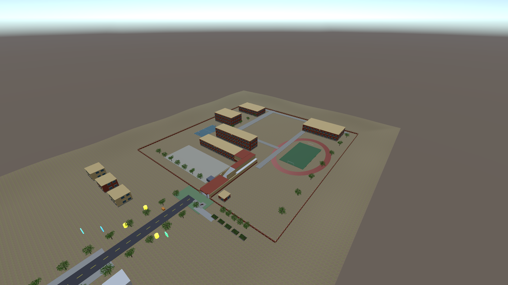
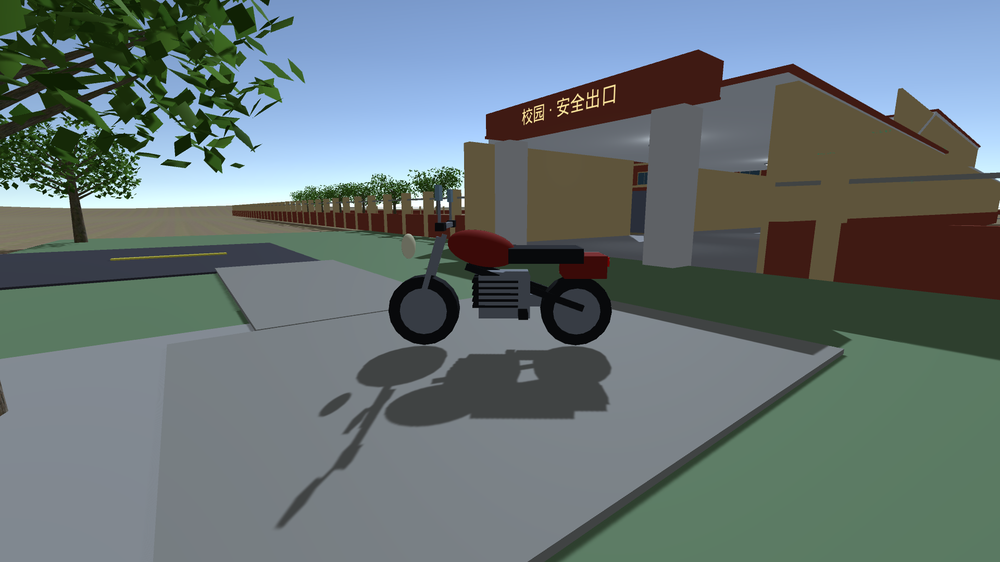

# 《逃离考场》

Unity 中文潜行逃脱游戏原型。当前推荐入口为 **`Assets/Scenes/CampusWorld.unity`**：从二楼考场出发，躲避老师，经走廊、楼梯逃出校园，再进入城镇完成回家留条、买手机、赚钱和旅行任务。

## 最新更新：校园总图与摩托车（2026-10-22 整理）

- **第一人称与现实比例**：人物身高 1.80 米，站立眼高 1.65 米；考场 9×12 米，桌椅采用米制尺寸，室内补全天花板和灯管。
- **红黄校园**：围界约 160×167 米（2.67 公顷），包括原有二楼考场、教学楼、图书馆、食堂、体育馆、跑道、篮球场、门卫室和围墙。
- **地面与建筑修复**：底层地形统一为 240×400 米网格，外围加入缓坡；移除同高交叠地面、重复楼体和蓝色发光校门占位板，三栋小房子分别占地，修正草地纹理重复过密。
- **可骑乘摩托车**：停在校门外，第一人称骑行，HUD 显示 km/h；按通勤车手感设置最高 90 km/h、加速 3.5 m/s²、制动 7 m/s²，支持坡地安全下车、连续碰撞和返回检查点。
- **追逐与提示**：抓捕者使用 NavMesh 绕障、遮挡后脱离追踪和同层抓捕；坠落返回最近检查点。灯光标志只显示在抓捕者上，普通灯管不带图标，默认关闭 Game 视图的导航调试覆盖层。





### 运行与操作

1. 使用 **Unity 2022.3.49f1c1** 打开工程，等待资源和 Package Manager 导入完成。本轮在该版本验证，使用 **Built-in Render Pipeline + 旧 Input Manager**。
2. 双击 `Assets/Scenes/CampusWorld.unity`，点击 Play，再点击 Game 视图锁定鼠标。
3. WASD 移动，Shift 奔跑，空格跳跃，Ctrl/C 蹲走，E 交互，M 地图，Esc 暂停。
4. 在二楼考场寻找出口，经二楼走廊和楼梯下到一楼，再走向标有“校园·安全出口”的校门。
5. 靠近门外摩托车按 **F 上车**；W 油门、S 减速、A/D 转向、空格刹车；速度降至 **9 km/h 以下**按 F 下车。
6. 更新项目时如仍在播放旧场景，先停止 Play，再重新打开 CampusWorld。

### 重建与验证

编辑器菜单 **EscapeExam → 验证并生成二楼校园** 可重新生成并保存场景。此操作会重建生成内容，手工修改场景前请先另存副本。完整检查入口为 `CampusSceneValidation.RunFinalChecks`，涵盖场景生成、资产保存、渲染和 Play 验证。

最近一次完整验证为 **2026-10-21**：二楼出生、天花板、站立/蹲伏眼高、穿窗碰撞、坠落恢复、导航路径，以及从考场至校门的实际逃脱测试均通过，逃脱用时约 **12.5 秒**。摩托车加速、90 km/h 限速、刹停、高速撞墙、坡地下车和骑行状态回位也通过物理步进检查。结果见 [验证记录](Docs/validation/campus-v10-result.txt)。

### 当前限制与后续方向

新增图书馆、食堂等楼体目前为封闭外观模型，尚未提供可进入的新室内；跑道为小型校园健身场，非标准 400 米田径场。摩托车采用自动平衡的游戏驾驶控制，尚无骑手手臂、发动机音效和悬架动画。整体仍是程序化原型，后续优先补教学楼入口、室内连接、砖墙 PBR 材质和骑行反馈。

实现、参数、参考与资源来源见 [校园总图与摩托车](Docs/12-校园总图与摩托车.md)、[资源来源与许可](Docs/05-资源来源与许可.md)。

## 演进说明

**校园碰撞与扩建更新**：抓捕者使用 NavMesh 绕障、有限视野记忆与同层抓捕；主角提速，掉出地图自动回最近检查点。校外地面扩为 180×180 米，补花园、街区和细化树木；普通灯管与警戒灯分开。见 [Docs/10-碰撞追逐与校园扩建.md](Docs/10-碰撞追逐与校园扩建.md)。

**当前 CampusWorld 为第一人称步行**：教室、走廊、楼梯间与家庭区域已封顶并添加室内灯光；玩家身高 1.80 米、站立眼高 1.65 米，教室为 9×12 米。打开 `Assets/Scenes/CampusWorld.unity` 直接 Play。尺寸、控制和验证详见 [Docs/09-第一人称与室内尺度.md](Docs/09-第一人称与室内尺度.md)。

**2026-10-21 二楼考场优化**：`CampusWorld` 从 201 二楼考场开始，经二楼走廊和 20 级楼梯下到一楼，再逃向校门。桌椅统一为米制尺寸；校园任务/交互提示由一个 HUD 绘制。打开场景直接 Play；重建可用 **EscapeExam → 验证并生成二楼校园**。框架、图片参考、技能安装及下一步建议见 [Docs/08-二楼考场优化与框架研究.md](Docs/08-二楼考场优化与框架研究.md)。

本项目正演进为中文叙事向 Unity 游戏 **《逃离考场》**：愿景是高考压力下的潜行逃出考场 → 逃出学校 → 乘高铁 / 飞机 / 地铁 / 车去各地旅行做任务；并探讨多人分考场逃脱后汇合。

**当前可玩（Built-in + 旧 Input Manager）**

| 切片 | 内容 | 入口 |
| --- | --- | --- |
| **v0.1 开世界** | 第三人称 WASD、F 上下车、开车至黄圈「任务完成」 | `OpenWorld` 场景 / 菜单 **OpenWorld → 生成占位场景** |
| **v0.2 考场潜行** | 监考视野锥、蹲走、课桌/柜子掩体、逃出考场 | 菜单 **EscapeExam → 生成考场场景** → Play |
| **v0.2 学校逃离** | 走廊巡逻、校门「逃出学校」 | 考场成功自动进入，或 **EscapeExam → 生成学校场景** |
| **v0.3 交通枢纽** | 综合站购票 / 闸机检票 / 机场值机占位 | **EscapeExam → 生成交通枢纽场景**（主线须先留条+手机） |
| **v0.3 旅行任务** | ≥3 中国地标黄圈 + 中文完成反馈 | 枢纽检票后进入，或 **EscapeExam → 生成旅行任务场景** |
| **v0.6 连通校园** | 同场景大地图：考场→走廊/楼梯/秘密通道→校门→公路城镇；审查灯光；安全回位；CC0 模型 | 打开 **`CampusWorld`** 直接 Play（或 **EscapeExam → 生成连通校园大地图**） |
| **v0.4 追赶·存档·旅行门槛** | 老师随机巡视追赶、抓住回座位学习、空格跳、Esc 暂停存读、逃出学校→现实城镇、地图、买手机、赚钱、回家留条后才能购票 | 菜单生成 **HubTown / Home**；主线：Exam→School→HubTown→Home→买手机/赚钱→Transit→Travel |

OSM 真地图与精美美术等尚未合入；**v0.5 联机骨架**（Netcode Host/Client，非完整产品）已在分支可测。代理 / 开发者请从 **`Docs/00-任务交接.md`** 读起。重型工作默认不做，须先与仓库维护者确认。

## 早期 OpenWorld 小原型

一个能在 Unity 里直接 Play 的第三人称小切片：走路，靠近红车按 **F** 上车，沿路开到黄色光柱，屏幕出现 **「任务完成」**。

本节描述旧 `OpenWorld` 场景，其方块/圆柱与第三人称操作不代表当前 CampusWorld 的全部内容。无需 Asset Store。

## 推荐版本

- **Unity 2022.3.49f1c1**（本轮实测）；其他版本需自行验证
- 工程按 **内置渲染管线（Built-in）** 保存
- 输入使用 **旧版 Input Manager**（`UnityEngine.Input`），没有安装 Input System 包

跨版本打开前建议备份；Unity 6 与其他渲染管线的迁移尚未验证。

用 URP / HDRP 打开时，编辑器里材质可能是粉色。进入 Play 后，脚本会按当前管线重新上色。验收以 Play 为准。

## 用 Unity Hub 打开

1. 安装 Unity 2022.3 LTS 或更新版本。
2. Unity Hub → **Add** → **Add project from disk**。
3. 选中本目录（里面要能看到 `Assets`、`Packages`、`ProjectSettings`）。
4. 打开工程。首次导入会生成 `Library`，等它结束。
5. 推荐双击 `Assets/Scenes/CampusWorld.unity`（连通大地图）；或 `OpenWorld.unity` 验收开世界切片。
6. 点编辑器上方的 **Play**。

场景里已经放好：地面、道路、方块楼、蓝色玩家、红色车、黄色光柱。直接 Play 就能验收，不用再摆物体。


## v0.6 连通校园怎么玩（推荐）

1. 用 Unity 打开工程，双击 `Assets/Scenes/CampusWorld.unity`（已在 Build Settings 第 0）。
2. 直接点 **Play**。若场景为空，`CampusWorldBootstrap` 会自动生成大地图；也可用菜单 **EscapeExam → 生成连通校园大地图** 把几何写入场景资产。
3. 在考场蹲走躲**冷红灯光**老师，可找**通风口**捷径；出绿门后进入走廊（**同地图不跳转**）。
4. 从二楼走廊经楼梯下到一楼，躲避巡逻；走到标有**校园·安全出口**的校门进入公路/城镇，门外可骑摩托车。
5. 城镇：买手机、黄圈赚钱、绿门回家（**冷紫灯光**家长）；蓝门仍可进 TransitHub / 旅行（远端场景）。
6. 被发现会安全送回检查点并短暂无敌，避免卡死连触。

## v0.2 考场 / 学校怎么玩

1. 退出 Play。菜单 **EscapeExam → 生成考场场景**（首次建议再点一次 **将场景写入 Build Settings**）。
2. 点 **Play**。点击 Game 视图锁定鼠标。
3. **WASD** 移动，**Ctrl** 或 **C** 蹲走；用课桌 / 柜子挡住监考视线。
4. 走进监考前方扇形且无遮挡会被发现，屏幕显示「被发现了」并回到出生点。
5. 绕到左侧绿色出口 →「逃出考场」→ 自动进入学校走廊（需 Build Settings 含 `SchoolEscape`）。
6. 学校关：避开巡逻追赶，走到蓝色校门 →「逃出学校」→ 进入现实城镇 HubTown（**不要**未留条就进枢纽）。

也可单独：**EscapeExam → 生成学校场景** 后直接验收学校段。  
开世界切片不变：仍用 **OpenWorld → 生成占位场景** / `OpenWorld.unity`。

## v0.3 交通枢纽 / 旅行怎么玩

1. 退出 Play。依次（或按需）执行：**EscapeExam → 生成交通枢纽场景**、**生成旅行任务场景**，并 **将场景写入 Build Settings**。
2. 可从学校通关自动进入枢纽，或直接打开 `TransitHub` 点 Play。
3. 靠近**橙色高铁窗口**（或右侧机场值机）按 **E** → 中文面板选「G-自由01」等 →「购票成功」。
4. **无票**走近蓝色闸机会提示先购票；**有票**走进闸机 →「检票通过」→ 加载 `TravelMissions`。
5. 旅行区走进三个黄圈（西湖断桥 / 长城烽火台 / 黄山迎客松）完成打卡，全部完成后显示通关反馈。

**已知限制**：无真实列车/安检动画；车票为静态状态；无 OSM；旅行区为开阔占位而非真实城市。


## v0.4 追赶 / 存档 / 旅行门槛怎么玩

1. 退出 Play。依次执行：**EscapeExam → 生成考场 / 学校 / 现实城镇 / 家庭 / 交通枢纽 / 旅行任务场景**，并 **将场景写入 Build Settings**。
2. 从考场 Play：老师**随机路点巡视**，视野发现后**追赶**；靠近抓住 → 送回座位「被迫学习」短暂锁定 → 再逃。**空格跳跃**；**Esc** 暂停（继续/保存/读取/退出）。
3. 逃出学校 → 进入 **HubTown**（**不会**直接进 TransitHub）。按 **M** 开世界地图。
4. 绿门回家：潜行避开家长，桌上 **E** 留条（文案：自己赚钱出去旅游）。被发现回屋内检查点。
5. 橙摊 **E** 买手机（花旅游资金）；黄圈任务赚钱；蓝门进枢纽（需已留条）。
6. 枢纽：无手机窗口只提示「需要手机才能查看票价」；有手机显示票价并扣款购票 → 闸机 → 旅行打卡（也给钱）。

**已知限制**：无真实列车动画；存档为 JSON/PlayerPrefs 简易槽；家长 AI 为发现即失败（带追赶压迫）；无 OSM。联机见下方 v0.5 骨架。


## v0.5 联机骨架（Host / Client · 非完整产品）

> **这是骨架**：可测 Host/Client 流程、分考场 spawn、逃出后汇合提示。  
> **不是**完整联机产品：无反作弊、无匹配服、无 Vivox 语音、无 Relay 付费（后期可选，见 Docs）。

### 依赖

- `Packages/manifest.json` 已加入 `com.unity.netcode.gameobjects` **1.12.0**（适配 Unity 2022.3）。
- **首次打开工程**：等 Package Manager 解析完 NGO / Transport 再 Play。本仓库不提交 `Library`。

### 怎么测（本机双开 / 局域网）

1. 退出 Play。菜单 **EscapeExam → 生成联机大厅/联机考场骨架**，并确认 Build Settings 含 `NetLobby` / `NetExamHall` / `NetMeetup`。
2. **方式 A · 编辑器 + 构建客户端**  
   - 编辑器打开 `NetLobby`，Play → **创建主机（Host）**（默认 `127.0.0.1:7777`）。Host 会加载联机考场。  
   - `File → Build and Run` 打一份 Windows/Mac 播放器，在播放器里打开联机大厅 → 地址填 Host 的局域网 IP（本机双开用 `127.0.0.1`）→ **加入（Client）**。
3. **方式 B · 两台机 LAN**  
   - Host 机器防火墙放行 UDP/TCP **7777**；Client 填 Host 局域网 IP。
4. 每人被分到不同考场座位；走进**绿门** → 传送到黄色**汇合点**；第二人到达后显示「队友已汇合」。
5. 单机主线不变：无 NetworkManager 会话时仍走 Exam→School→HubTown…；Esc 暂停可进「联机大厅」作为可选入口。

### 限制

- 老师 AI / 潜行不同步为权威战场（本地占位）；位置同步为最小 Owner 写 NetworkVariable。
- 无 Relay：仅本地 / 局域网 Unity Transport。
- 依赖未合入的 **v0.4** 机制时，请先合 PR #4 或将本 PR base 设为 v0.4 分支。

## 怎么玩（验收）

1. 点击 **Game** 视图（否则键盘鼠标进不了游戏）。
2. 屏幕提示「点击游戏画面，开始控制镜头」。点一下，鼠标被锁定。
3. **WASD** 朝镜头方向走，鼠标转动镜头。玩家在红车正后方。
4. 走到车尾，底部出现 **「按 F 上车」**，按 **F**。
5. **W** 前进、**A / D** 转向、**S** 倒车、**空格** 刹车。沿虚线开到路尽头的黄色光柱。
6. 车头开进黄圈后，画面中央出现 **「任务完成」**。

开车时再按 **F** 可以下车。**Esc** 释放鼠标。

| 操作 | 步行 | 开车 |
| --- | --- | --- |
| W A S D | 相对镜头移动 | 油门 / 转向 / 倒车 |
| 鼠标 | 转动镜头 | 转动镜头 |
| Shift | 冲刺 | — |
| 空格 | 跳跃 | 刹车 |
| F | 靠近红车时上车 | 下车 |
| Esc | 释放鼠标 | 释放鼠标 |

请用英文输入法，避免 **F** 被输入法吃掉。

## 如果场景空了

菜单栏 **OpenWorld → 生成占位场景**。

它会按脚本重新摆地面、建筑、玩家、车和任务点，并保存 `OpenWorld.unity`。然后再 Play。

**OpenWorld → 打开原型场景** 用来切回这个场景。

## 脚本

| 文件 | 作用 |
| --- | --- |
| `Assets/Scripts/Player/ThirdPersonController.cs` | 第三人称走路、冲刺、跳跃 |
| `Assets/Scripts/Player/ThirdPersonCamera.cs` | 鼠标轨道镜头，跟着人或车 |
| `Assets/Scripts/Vehicle/VehicleController.cs` | 前进、倒车、转向、刹车 |
| `Assets/Scripts/Vehicle/PlayerVehicleSwitch.cs` | F 上下车，切换控制和镜头 |
| `Assets/Scripts/Mission/MissionCheckpoint.cs` | 黄圈触发，标记完成 |
| `Assets/Scripts/Mission/MissionHUD.cs` | 屏幕提示，包括「任务完成」 |
| `Assets/Scripts/World/PrototypeWorldBuilder.cs` | 生成占位街区 |
| `Assets/Editor/PrototypeSceneMenu.cs` | 编辑器菜单 |
| `Assets/Scripts/Transit/` | v0.3 购票 / 检票 / 枢纽生成 |
| `Assets/Scripts/Travel/` | v0.3 旅行地标任务 |
| `Assets/Editor/EscapeExamSceneMenu.cs` | EscapeExam 全流程场景菜单 |
| `Assets/Scripts/Net/` | v0.5 联机骨架（Host/Client、分考场、汇合） |

界面中文使用 `Assets/Resources/UIFont.ttf`（Droid Sans Fallback，Apache 2.0）。许可证在 `Assets/Fonts/LICENSE-DroidSansFallback.txt`。

## 输入说明

工程的 `ProjectSettings` 里 `activeInputHandler` 为 **Input Manager (Old)**。

如果以后装了 Input System，并且弹出选择窗口，请保持 **Input Manager** 或 **Both**。不要改成只使用新输入系统，否则 WASD 会失效。

## Agent Skills

本仓库已经带好给 Cursor / 云端代理用的 skills。文件在 `.agents/skills/<名称>/SKILL.md`。`.cursor/skills` 是指向该目录的链接，两边看到的是同一套。

`npx skills add -a cursor` 会把 skill 装进 `.agents/skills`，并写进根目录的 `skills-lock.json`。玩法脚本和场景没有因此改动。

### Unity 官方（34 个，整套）

来源：[Unity-Technologies/skills](https://github.com/Unity-Technologies/skills)（Unity Companion License）。

`2d-pixel-perfect`、`asset-transformer-toolkit`、`audio-setup-mixers`、`build-gtk`、`build-live-game`、`create-2d-physics`、`create-tile-palette-or-rule-tiles`、`generate-editor-search-query`、`implement-in-app-purchases`、`initialize-ai-navigation`、`levelplay-unity-integration`、`localization`、`manage-sprite-atlas`、`migrate-birp-to-urp`、`new-unity-project`、`optimize-audio`、`optimize-text-mesh-pro`、`optimize-web`、`physics-3d-collision`、`project-auditor-fixes`、`setup-multiplayer-services`、`setup-vivox-voice-chat`、`shader-graph-create-custom-node`、`sprite-editor`、`sprite-segment-3x3grid`、`ui`、`ui-imgui`、`ui-ugui`、`ui-uitk`、`unity-cli`、`unity-package-management`、`unity-pipeline`、`urp-postprocessing`、`validate-urp-render-graph-renderer-feature`。

### 社区游戏向（15 个，只留和本原型相关的）

来源：[gamedev-skills/awesome-gamedev-agent-skills](https://github.com/gamedev-skills/awesome-gamedev-agent-skills)（Apache 2.0）。没有装 Godot、Unreal、Roblox 或其他引擎整包。

- 路由：`router`
- Unity：`unity-animation`、`unity-build-pipeline`、`unity-csharp-scripting`、`unity-input-system`、`unity-navmesh`、`unity-physics`、`unity-scriptableobjects`、`unity-tilemap-2d`
- 工作流：`prototype-fast`
- 通用：`camera-systems`、`input-systems`、`game-feel`、`level-design`、`physics-tuning`

上游 router 里写的路径 `skills/unity/<名称>/SKILL.md`，在本仓库对应 `.agents/skills/<名称>/SKILL.md`。

### 更新

在仓库根目录执行。已安装的全部按锁文件更新：

```bash
npx skills update -p -y
```

重新装官方整套：

```bash
npx skills add Unity-Technologies/skills -a cursor -s '*' -y --copy
```

只补社区里这 15 个（`--full-depth` 才会扫到子目录）：

```bash
npx skills add gamedev-skills/awesome-gamedev-agent-skills -a cursor --full-depth -y --copy \
  -s router \
  -s unity-animation -s unity-build-pipeline -s unity-csharp-scripting \
  -s unity-input-system -s unity-navmesh -s unity-physics \
  -s unity-scriptableobjects -s unity-tilemap-2d \
  -s prototype-fast \
  -s camera-systems -s input-systems -s game-feel -s level-design -s physics-tuning
```
